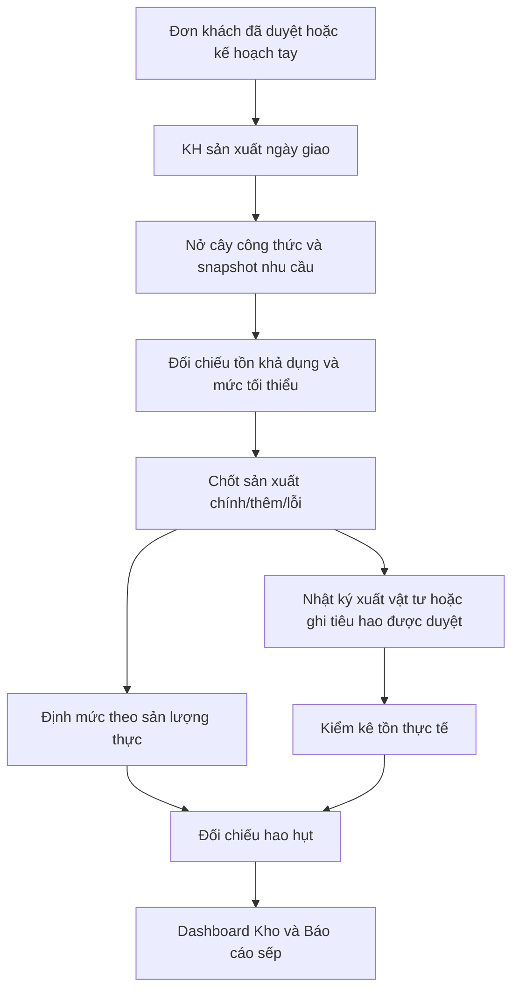
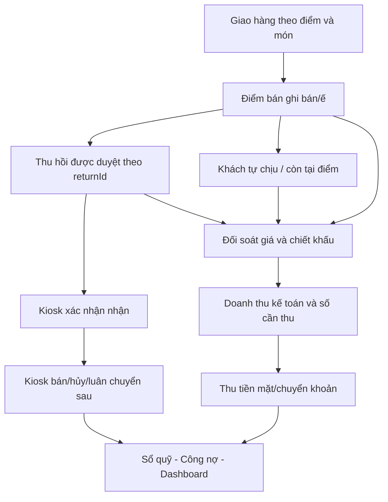
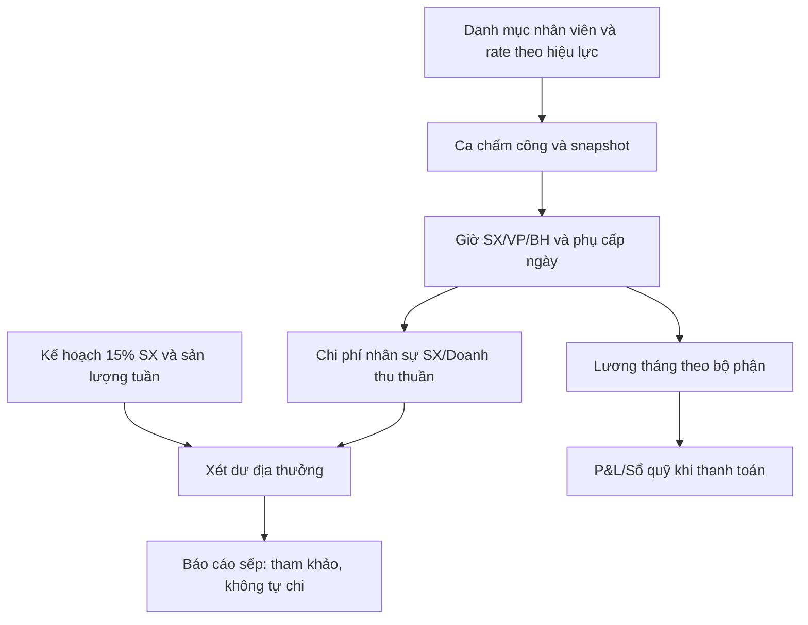

# 03 — MÔ HÌNH DỮ LIỆU VÀ LUỒNG NGHIỆP VỤ LIÊN PHÂN HỆ

## Nguyên tắc thiết kế

- **Google Sheets là nguồn dữ liệu canonical** trong phạm vi giới hạn vận hành đã nêu. Dashboard/chart là read-model, không ghi số dư/tiền/SL tự tính làm nguồn thứ hai.
- Không dùng tên tiếng Việt làm khóa liên kết; dùng ID bất biến, mã hiển thị duy nhất, lưu lịch sử đổi tên. `businessDate`, `createdAt`, `updatedAt`, `version`, `updatedBy`, `source`, `status`, `deletedAt/reversedBy` phải có.
- Tách master (cho sửa trực tiếp Sheets ở ô được duyệt) và chứng từ ledger (chỉ thêm/đảo qua app hoặc quy trình được duyệt). Không để kế toán chỉnh `_Users`, `_Sessions`, `_Audit`, `_Requests`, metadata, mã ID, công thức kỹ thuật.
- Đề xuất dưới đây là **schema đích để Codex mapping**, không được tạo một hệ thống khác phủ lên schemas đã có mà chưa migration/compare.

## 1. Nhóm master

| Sheet logic | Khóa & trường quan trọng | Thay đổi được trực tiếp trên Sheets? |
|---|---|---|
| `MATERIALS` | materialId/code, name, group, purchaseUom, usageUom, stockUom, conversion, packSpecification, purchasePrice, minimum, active | Có: tên, nhóm, quy cách, đơn giá, tồn tối thiểu (có kiểm tra và hiệu lực); không sửa ID |
| `MATERIAL_PRICE_HISTORY` | materialId, effectiveFrom, price, priceUom, supplier | Có qua luồng thêm mới/dòng hiệu lực; tránh viết đè giá lịch sử |
| `DISHES` | dishId/code, name, unit, category, salePrice, published, active | Có các ô được cấp quyền |
| `STORES` | storeId/code, name, type (point/kiosk), contact, status | Có dữ liệu mô tả |
| `EMPLOYEES` | employeeId/code, name, dept, rate, allowanceAmount, allowancePolicy, status | Có nếu được cấp quyền; mọi thay đổi lương ghi lịch sử |
| `DISCOUNT_RULES` | storeId, dishId, percent, effectiveFrom/To, recoveryPriceDefault | Có hiệu lực theo kỳ, validation 0–100% |
| `DEPARTMENTS` | SX/VP/BH + tên | Admin quản trị |
| `LOCATIONS` | kho nguyên liệu, điểm bán, kiosk | Admin quản trị |
| `UOM_CONVERSIONS` | itemId, fromUom, toUom, factor, effectiveFrom | Admin/quản lý duyệt |

## 2. Công thức/giá vốn

| Sheet logic | Quan hệ |
|---|---|
| `RECIPES` | recipeId, name, kind=DISH/BATCH/RICE/SAUCE/PACKAGING, outputQty/outputUom, validFrom/To, version, status |
| `RECIPE_LINES` | recipeLineId, recipeId, componentType=MATERIAL/RECIPE, componentId, quantity, uom, wastePct, order |
| `PRODUCT_RECIPE_LINKS` | dishId, recipeId, effectiveFrom/To, version |
| `COST_SNAPSHOTS` | dishId, businessDate, recipeVersion, priceVersion, unitCost, completeness, approvedAt |
| `MATERIAL_REQUIREMENT_SNAPSHOTS` | planId/productionId, date, materialId, planned/theoretical qty, unit, recipeVersion, createdAt |

> **Migration cần chú ý:** `Code.gs` mẫu đang lưu các `lines` của `recipes` vào một ô JSON. Điều đó **không đáp ứng đầy đủ yêu cầu sửa từng dòng công thức trực tiếp trên Sheets**. Codex phải thiết kế bảng dòng `RECIPE_LINES` chuẩn hóa hoặc editor có mapping đáng tin, đồng thời có script chuyển dữ liệu cũ; không mất recipe hiện tại.

## 3. Sản xuất, kho, kiểm kê

| Sheet logic | Khóa và trường |
|---|---|
| `PRODUCTION_PLANS` | planId, productionDate, createdDate, dishId, plannedQty, source=MANUAL/ORDER, linkedOrderLineId, status |
| `PRODUCTION_EVENTS` | eventId, productionDate, dishId, type=MAIN/EXTRA/REJECT/REWORK/DISCARD, qty, batchId, author, status, correctionRef |
| `STOCK_MOVEMENTS` | movementId, materialId, locationId, type=OPENING/IN/OUT/TRANSFER_IN/TRANSFER_OUT/ADJUST/REVERSE, qty, uom, costSnapshot, sourceDocType/sourceDocId, status |
| `STOCK_COUNTS` | countId, date, locationId, materialId, countedQty, uom, approvedBy, status |
| `STOCK_VARIANCE` | periodFrom/To, materialId, theoretical, actual, difference, percent, dataQuality, reconciliationId, reviewerReason |
| `REPLENISHMENT_REQUESTS` | materialId, availableQty, minimumQty, forecastDemand, suggestedBuy, status, reviewer |

**Đừng lập số tồn bằng cách nhập thủ công vào `MATERIALS` mỗi lần nhập kho**. `minimum` là target; tồn thực tế từ ledger + kiểm kê đã được duyệt. Dữ liệu kho từ 2 file cũ phải có phiếu tồn đầu khi chuyển hệ thống.

## 4. Thành phẩm, điểm bán, thu hồi, kiosk

| Sheet logic | Khóa và trường |
|---|---|
| `DELIVERIES`/`DELIVERY_LINES` | deliveryId, productionDate, storeId, dishId, deliveredQty, batchId, status |
| `STORE_SALES_LINES` | saleId, businessDate, storeId, dishId, deliveredRef, soldQty, borneQty, priceSnapshot, discountRuleSnapshot, status |
| `RETURNS` | returnId, businessDate, storeId, dishId, approvedQty, recoveryPriceSnapshot, reason, approver, status |
| `KIOSK_MOVEMENTS` | kioskTxnId, returnId, kioskLocationId, dishId, qty, kind=RECEIPT/SALE/DISCARD/TRANSFER, status |
| `STORE_DISCARDS` | storeId, dishId, quantity, reason, responsibility, approval |
| `SALES_SETTLEMENTS` | settlementId, date, storeId, gross, discounts, recoverySupport, oldDebtOffsets, adjustments, amountDue, cashPaid, bankPaid, debtCreated, status |
| `COLLECTIONS` | collectionId, date, settlementRef/ARRef, method=CASH/BANK, amount, recordedAt, status |

**Mối nối quan trọng:** `DELIVERY_LINE → STORE_SALE_LINE → RETURN(returnId) → KIOSK_RECEIPT → KIOSK_SALE`. `Return` là một nghiệp vụ duy nhất, màn `Sản xuất – trả về` và `Doanh thu` phải đọc cùng row/event. Không được tạo KIOSK inbound nếu chưa nhận thực tế; mỗi `returnId` tối đa một receipt được tính hiệu lực (nếu có bổ sung tách IDs con rõ ràng).

## 5. Nhân sự, tài chính, kế hoạch, đơn hàng

| Sheet logic | Quan hệ/trường |
|---|---|
| `ATTENDANCE_SHIFTS` | shiftId, employeeId, startAt/endAt timezone, businessDate, deptSnapshot, rateSnapshot, hours, allowancePolicy, dayAllowance, support, status |
| `PAYROLL_ADJUSTMENTS` | employeeId, payrollPeriod, kind=BONUS/ADVANCE/DEDUCTION/SUPPORT, amount, approver, reference |
| `PAYROLL_PERIODS`/`PAYROLL_LINES` | period, employee, dept, hours, wages, allowance, support, bonus, advance, deduction, net, status |
| `CASH_JOURNAL` | txnId, txnDate, direction, account CASH/BANK, category, amount, linkedDocumentType/Id, status |
| `ACCOUNTS_RECEIVABLE/PAYABLE` | debtorId, original, balanceCalculated, dueDate, settlementRefs, status |
| `LOANS` / `LOAN_EVENTS` | loanId, principal, rate, drawdown, due, paymentPrincipal/Interest, ref to cash |
| `ASSETS` / `DEPRECIATION` | assetId, originalCost, salvage, months, startDate, bookedEntries |
| `OPERATING_EXPENSES` | expenseId, date, type=PRODUCTION/OFFICE/FIXED/MARKETING/OTHER, amount, department, journalRef |
| `TARGETS` | periodKey, metricCode, targetValue, unit=PERCENT/VND/QTY, validFrom/To, user |
| `CUSTOMER_ORDERS`/`ORDER_LINES` | orderId, customerId, store/delivery, businessDate, dishId, qty, status, approval/ref |
| `ORDER_EVENTS` | orderId, from/to, actor, reason, timestamp |

Một khoản thu từ khách phải có **một nguồn hạch toán tiền**, dù UI phiếu doanh thu và sổ quỹ đều hiển thị. Một `transactionRef`/`collectionId` có thể hiện ở hai màn nhưng chỉ ghi một dòng có hiệu lực. Thu nợ cũ phải liên kết AR thay vì cộng thêm doanh thu mới.

## 6. Hệ thống và bảo mật

| Sheet logic | Nội dung | Quyền |
|---|---|---|
| `_Users` / `APP_USERS` | email/google subject, role, enabled, permissionVersion | Owner/Admin qua RPC; không cấp Editor trực tiếp |
| `_Permissions` | user/role, module, action, scope | Admin chỉ qua API |
| `_Sessions` | sessionId, tokenHash, created/expires/revoked, deviceLabel, lastSeen | Server-only |
| `_SecurityAlerts` | login-denied, new-session, account lockout, admin-one-session | Server-only |
| `_Audit` | trước/sau, actor, module, IP/device nếu sẵn có một cách đáng tin, timestamp | Append-only, server-only |
| `_Requests` | idempotencyKey, requestHash, status=PREPARED/APPLIED/FAILED/RECOVERED, result | Server-only |
| `_Sync` | module, rowId, version, hash, lastObserved, invalidRows | Server-only |
| `_Jobs` | sync, report materialization, backup, migration jobs, cursor | Server-only |
| `_Config` | target, category options không bí mật | Admin; secrets ở Script Properties |

Không được đặt sheet system này chung workbook được cấp Editor cho nhân viên. Nếu mô hình access đòi cấp Editor cả Sheets thì không thể coi RBAC UI là bảo mật; thiết kế phải tách storage hoặc auth theo quyền sở hữu một cách an toàn.

## 7. Luồng nghiệp vụ 1: kế hoạch ngày mai → xuất kho → báo cáo

## 8. Luồng nghiệp vụ 2: giao điểm bán → tiền và kiosk

## 9. Luồng nghiệp vụ 3: chấm công → chi phí SX → thưởng

## 10. Luồng nhập bù/sửa và đồng bộ hai chiều

- **App edit:** Client lấy row + version + hash; gửi mutation có idempotencyKey; server `auth→RBAC→validate→lock→re-read→compare→write + audit→bump revision`; client nhận ACK rồi cập nhật UI.
- **Sheets edit:** Người đủ quyền sửa ô business trong master; trigger `onEdit` (khi có) và reconcile định kỳ phát hiện patch/hash; validate theo schema; nếu hợp lệ bump `version`, log `source=SHEET`, publish revision; nếu không hợp lệ đánh `quarantine/invalid` và cảnh báo, **không biến dữ liệu sai thành số thực tế**.
- **Conflict:** App đang chỉnh version 5, Sheets đổi thành version 6; app lưu version 5 => `CONFLICT`, modal diff/reload/apply lại có xác nhận, không overwrite.
- **Bulk paste/row deletion:** Need scan checksum and missing ID handling, no silent row recreation into wrong data; thao tác xóa metadata bị chặn, detect structural changes và dừng thay vì ghi sai cột.
- **Changes via Apps Script/API** không tự kích hoạt `onEdit`; bump revision trong RPC và có periodic reconciliation cho những thay đổi bên ngoài.

## 11. Import hai workbook cũ

1. Backup/copy nguồn READ ONLY (cùng cấu hình truy cập chặt), inventory từng sheet/cột/row/formula/foreign link.
2. Lập `LEGACY_MAPPING`: `sourceWorkbook/sheet/cellRange → targetTable/field`, loại giá trị `DIRECT`, `FORMULA`, `ERROR`, `UNVERIFIED`, `DERIVED`.
3. Preview conversion and duplicates (mã vật tư, món, điểm bán, NV); xử lý UOM, chuỗi ngày, giá thiếu, dòng `#REF!`, và số lệch đối chiếu.
4. Import theo thứ tự: master → price/discount → recipes → opening stocks → events → settlements → payroll/financial → targets; ghi provenance và `importBatchId`.
5. So sánh hàng/tổng tiền/tồn/SL/giờ, dry-run và rollback từng batch. Không import dashboard KPI như số nhập nguồn mới; tái tính dashboard từ chứng từ.

## 12. Deploy và độ bền

- Một lần chạy `setup` để tạo bảng DEV; không chạy lại làm xóa cũ; migrations versioned.
- `clasp push` chỉ đưa source lên Apps Script, không đồng nghĩa `/exec` production dùng mã mới; phải `new version` trên deployment hiện có. `/dev` dành editor, source HEAD.
- Không lưu định danh/secret nhạy cảm trong frontend và Git. Lưu snapshot backup hằng ngày, giữ bản khôi phục độc lập, thử restore sang workbook mới trước khi đổi SPREADSHEET_ID.
