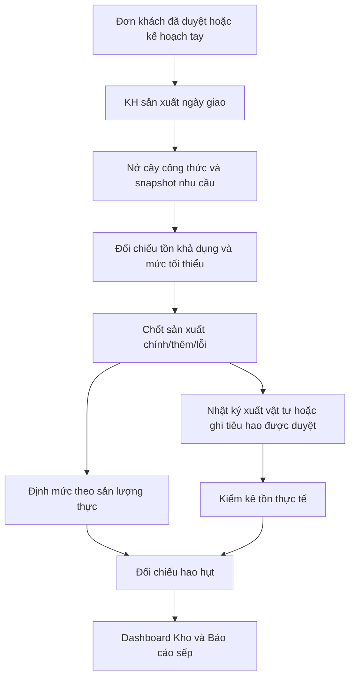
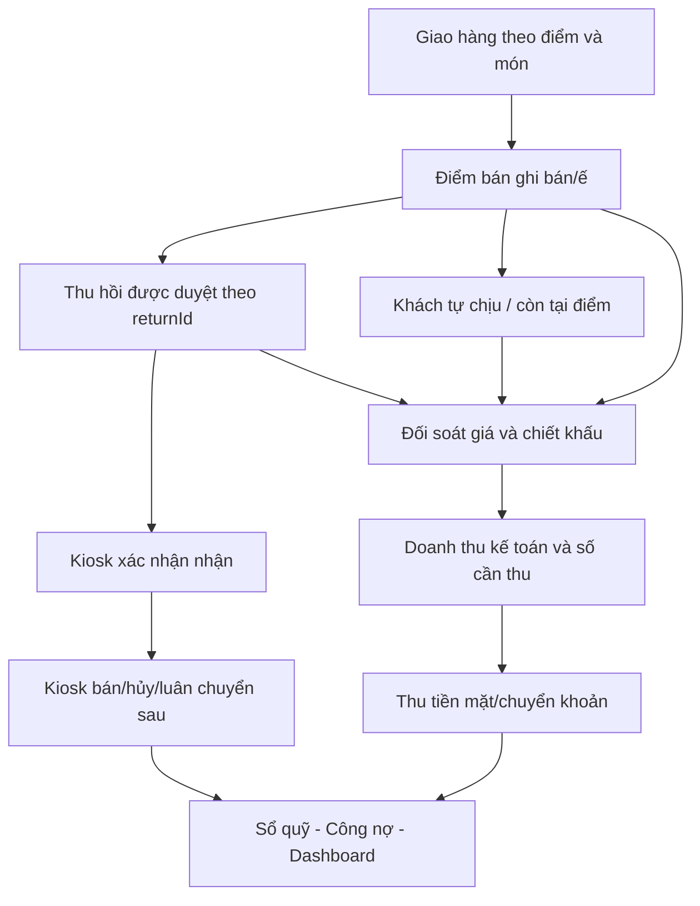
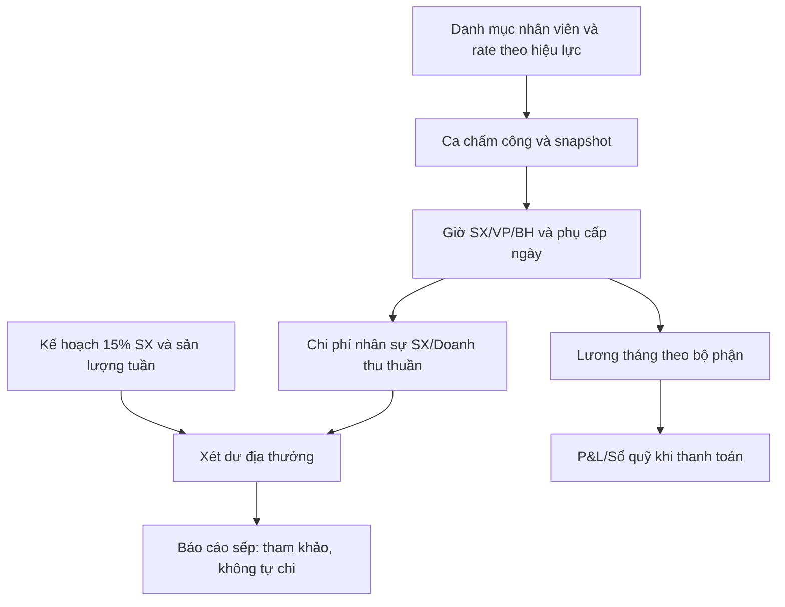

# CHIFAA COMBINE — TỔNG HỢP ĐẦY ĐỦ MỌI YÊU CẦU CHO CODEX

> Tài liệu gộp tất cả nội dung để tra cứu một file. **Để tránh quá tải context, nên giao Codex `PROMPT_GIAO_CHO_CODEX.md` trước, sau đó agent đọc từng file chuyên đề khi đến task tương ứng.**


---

<!-- SOURCE: README_BAT_DAU.md -->

# CHIFAA COMBINE — Bộ đặc tả tổng hợp để Codex nối logic

**Bản tổng hợp yêu cầu xuyên suốt cuộc trò chuyện đến 16/11/2026.** Đây là tài liệu yêu cầu, KHÔNG phải khẳng định hệ thống đã được lập trình/kiểm thử thành công.

## Bắt đầu trong 2 phút

1. Sao chép toàn bộ thư mục tài liệu này vào gốc repository CHIFAA mà Codex đang dùng, trong `docs/requirements/` hoặc giữ nguyên tên thư mục.
2. Giữ nguyên mã nguồn Codex hiện có. **Không reset repo, không thay toàn bộ ứng dụng bằng bản HTML phác thảo.** File HTML `CHIFAA_COMBINE_V17_CHIEN_LUOC_KINH_DOANH.html` là tham chiếu giao diện/ý tưởng, không phải backend chạy thật.
3. Mở `PROMPT_GIAO_CHO_CODEX.md`, sao chép toàn bộ nội dung, gửi vào Codex. Yêu cầu Codex đọc các tệp trong thứ tự chỉ định.
4. Codex phải lập `REQUIREMENT_MATRIX.md` so khớp từng mã REQ với code, test và trạng thái Done/Partial/Missing/Blocked; sau đó sửa theo lộ trình, không tự tuyên bố đã hoàn thành.
5. Khi hết phiên, dùng `PROMPT_TIEP_TUC.md`; thông tin hoàn thành, blocker và các lệnh chạy ghi trong `HANDOFF.md` tại repo.

## Các tài liệu

| Tệp | Công dụng |
|---|---|
| `PROMPT_GIAO_CHO_CODEX.md` | Prompt chính, có thể sao chép nguyên văn |
| `01_DAC_TA_NGHIEP_VU.md` | Yêu cầu từng phân hệ, người dùng, ví dụ, quy tắc xuyên suốt |
| `02_QUY_TAC_TINH_TOAN_DOI_SOAT.md` | Công thức, mẫu số, các trường hợp chống tính trùng và các điểm chưa chốt |
| `03_MO_HINH_DU_LIEU_VA_LUONG_NGHIEP_VU.md` | Mô hình Sheets, khóa liên kết, sự kiện, trạng thái và chuỗi dữ liệu |
| `04_KIEN_TRUC_DONG_BO_BAO_MAT_HIEU_NANG.md` | Apps Script/Google Sheets hai chiều, xác thực, cache, latency, recovery |
| `05_GIAO_DIEN_DASHBOARD_VA_UX.md` | Bản đồ menu, báo cáo, biểu đồ, thương hiệu, animation |
| `06_KIEM_THU_NGHIEM_THU.md` | Các ca kiểm thử nghiệp vụ, phân quyền, dữ liệu, hiệu năng |
| `07_TASKS_LO_TRINH.md` | Lộ trình theo task có điều kiện đầu vào/đầu ra và checkpoint |
| `08_NHUNG_DIEM_CAN_CHOT.md` | Danh sách vấn đề tài chính, đơn vị, OAuth, nhập liệu... không được tự suy đoán |
| `09_HIEN_TRANG_MA_NGUON_VA_CACH_GHEP.md` | Các dấu mốc bản HTML V1–V17, mã GAS đã gửi, các vấn đề đã phát hiện |
| `AGENTS.md` | Quy tắc thao tác trong repo cho agent |
| `PROMPT_TIEP_TUC.md` | Prompt khởi động lại nếu hết context/token |

## Quy ước ưu tiên khi thông tin mâu thuẫn

1. **Yêu cầu người dùng xác nhận rõ trong các lượt chat muộn hơn** ưu tiên hơn nội dung mô phỏng HTML cũ.
2. Quy tắc có ảnh hưởng doanh thu/lương/kho **chưa thống nhất** được đánh dấu `DECISION_REQUIRED`, không âm thầm chọn một cách tính.
3. Dữ liệu gốc của hai workbook là chứng cứ cần kiểm tra; mọi `#REF!`, ô trống, số giá 0 chưa xác nhận **không biến thành 0 hợp lệ**.
4. Code hiện hữu là nguồn để kiểm kê và giữ phần đã chạy; không mặc định rằng code hiện tại đã đúng mọi nghiệp vụ.
5. Dữ liệu minh họa trong HTML V17 tách khỏi dữ liệu được xác thực của Google Sheets.

## Nguồn người dùng từng gửi

- `DASHBOARD  VẬN HÀNH CHIFAA..xlsx`
- `DASHBOARD KẾ TOÁN CHIFAA.xlsx`
- File HTML từ phác thảo V1 đến V17, ưu tiên **V17 đã sửa sidebar** cho giao diện cuối cùng.
- Logo gốc `logochifaa(1).jpg` (không dùng ảnh tìm kiếm/vẽ lại).
- Mã `Code.gs` đã chia sẻ qua `Văn bản đã dán (1)(20261115-104754).txt` (734 dòng) — cần so với repo mới nhất của Codex.
- Transcript/hình ảnh yêu cầu về tồn kho, nhập bù, doanh thu, lương, trả hàng, mục tiêu, dashboard, báo cáo sếp.
- 19 file video MP4 đã gửi trước đây: **chưa có bản phiên âm được xác nhận cho tất cả**, không coi video chưa giải mã thành yêu cầu chắc chắn.

## Phạm vi

Đích đến là ứng dụng nội bộ vận hành CHIFAA (dưới 10 người đồng thời) có cổng đặt hàng khách, dữ liệu lưu Google Sheets, chỉnh được trên cả Sheets và ứng dụng ở các vùng cho phép, phân quyền thật, báo cáo chính xác, và khả năng sử dụng mượt. Không dùng `IMPORTRANGE` làm trục đồng bộ ứng dụng. Từ phác thảo đến hệ thống production là công việc cần triển khai/kiểm thử theo từng task, **không được tuyên bố hoàn thành chỉ vì có giao diện**.


---

<!-- SOURCE: PROMPT_GIAO_CHO_CODEX.md -->

# PROMPT GIAO CHO CODEX — NỐI LOGIC HOÀN CHỈNH CHIFAA COMBINE

Bạn đóng vai Principal Engineer (Google Apps Script + Sheets), BA, Kế toán quản trị, Data Architect, Security Engineer và QA Lead, tiếp tục **repository CHIFAA hiện tại**. Người dùng đã phác thảo rất nhiều phiên bản HTML; nhu cầu bây giờ là **kết nối dữ liệu và nghiệp vụ thật, đúng số, có thể sử dụng lâu dài**.

## 0. NGUYÊN TẮC KHÔNG ĐƯỢC VI PHẠM

- ĐỌC hết tài liệu trong thư mục này theo thứ tự: `README_BAT_DAU.md`, `01_DAC_TA_NGHIEP_VU.md`, `02_QUY_TAC_TINH_TOAN_DOI_SOAT.md`, `03_MO_HINH_DU_LIEU_VA_LUONG_NGHIEP_VU.md`, `04_KIEN_TRUC_DONG_BO_BAO_MAT_HIEU_NANG.md`, `05_GIAO_DIEN_DASHBOARD_VA_UX.md`, `08_NHUNG_DIEM_CAN_CHOT.md`, `09_HIEN_TRANG_MA_NGUON_VA_CACH_GHEP.md`, `06_KIEM_THU_NGHIEM_THU.md`, `07_TASKS_LO_TRINH.md`, `AGENTS.md`.
- Sau khi đọc, kiểm kê thực tế repo, file HTML nguồn, `Code.gs`, `appsscript.json`, Script Properties (chỉ tên khóa, không in giá trị bí mật), Google Sheets DEV, trigger, deployment, cấu hình OAuth. **Tạo `REQUIREMENT_MATRIX.md`: mỗi REQ có status DONE/PARTIAL/MISSING/BLOCKED, đường dẫn source, test, bằng chứng.** Không được tự nhận Done vì có code chưa test.
- Giữ UI navy/cam, tên CHIFAA COMBINE và logo đúng ảnh gốc; bỏ chữ “V16/V17/bản demo nội bộ/nhìn là hiểu ngay” ở giao diện khách, nhưng vẫn cho biết là dữ liệu mô phỏng ở chế độ xem trước. Sidebar dropdown, icon, label không vỡ chữ khi thay tab.
- Không phá dữ liệu! **Chỉ chạy migration trên Sheets DEV**; hai workbook gốc read-only và sao lưu trước import; không xóa/ghi đè file gốc. Tạo schema chuẩn, mapping, preview import, báo cáo lỗi, đối chiếu count/tổng, rollback. `#REF!` khác 0.
- Không tự chốt các công thức còn tranh luận: doanh thu hàng trả, giá hỗ trợ, 10 phần điểm bán chịu, food cost theo doanh thu nào, công thức khấu hao, giá trị 0, định mức mẻ... Ghi `DECISION_REQUIRED`, triển khai chế độ hiển thị provisional/đủ dữ liệu thay vì sai im lặng.
- Nguồn dữ liệu chính là Google Sheets; HTML demo/localStorage không phải sổ sách. Chỉ nói “Lưu thành công” sau xác nhận server. Thêm idempotency/lock/version/audit/recovery, không tin dữ liệu gửi từ UI, không tin quyền chỉ vì menu ẩn.
- Kiểm soát OAuth: đã gặp lỗi `401 invalid_client — no registered origin` khi dùng Google Identity Services trong Apps Script iframe. Không yêu cầu người dùng cứ thêm Gmail vào `_Users` để sửa lỗi này. Làm security feasibility spike **đầu tiên**, kiểm thử truy cập thật với 2 Gmail; nếu chưa có giải pháp an toàn chỉ Apps Script thì BLOCKED, nêu rủi ro và phương án rõ ràng; **không mở dữ liệu nội bộ public** hoặc vô hiệu hóa auth để chạy thử.
- Không thay bất ngờ mô hình `executeAs`. Người dùng muốn Apps Script + Sheets, Admin/kế toán dùng Gmail, các tài khoản KHÔNG cần được Editor trên toàn bộ file tài chính. Nếu `USER_ACCESSING` buộc cấp quyền Sheets toàn bộ thì không đạt yêu cầu bảo mật. Nếu `USER_DEPLOYING` thì `Session.getActiveUser().getEmail()` không đáng tin trong mọi ngữ cảnh; cần xác thực danh tính có bằng chứng thực tế. Không nhầm Apps Script OAuth cấp quyền chạy script với đăng nhập ứng dụng.
- Phải cập nhật `HANDOFF.md`, `TASKS.md`, `CHANGELOG.md`, test và commit sau mỗi task. Khi gần hết token, checkpoint trước: không bỏ trạng thái dở dang, không tự tuyên bố hoàn thành.

## 1. ĐÍCH ĐẾN

Ứng dụng CHIFAA COMBINE chạy trên Google Apps Script + Google Sheets (dưới 10 người dùng đồng thời), chi phí thấp, SPA không reload tab, đủ phân hệ danh mục – công thức đa tầng – kế hoạch sản xuất – kho, tồn, kiểm kê, hao hụt – doanh thu/điểm bán/ki-ốt – chấm công 3 bộ phận – lương – công nợ/sổ quỹ/khoản vay – mục tiêu – dashboard điều hành/vận hành – chiến lược/biểu đồ – đơn khách. Có đăng nhập Google, Admin toàn quyền, quản lý users/RBAC, một phiên Admin đang hoạt động, thông báo phiên mới, logs/backup. **Sửa được dữ liệu từ cả UI và các cột được phép trong Sheet; đồng bộ có version/xung đột.**

## 2. QUY TRÌNH BẮT BUỘC

### Giai đoạn 1 — Khảo sát và khóa rủi ro
1. Xuất sơ đồ thật của repo, chức năng mỗi trang/nút/biểu mẫu; map toàn bộ menu V17 và những phân hệ có trong các bản cũ nhưng V17 thiếu.
2. Chạy tests/ build hiện có, lưu baseline; kiểm tra thật đường `/dev`, `/exec`, phiên bản deployment và `clasp push`, không tin rằng `/exec` tự cập nhật.
3. Làm POC Google authentication/identity/role + session, xử lý 401 origin; bắt buộc chứng minh `admin1` có quyền, `accountant1` chỉ phần được cấp, email không nằm `_Users` bị từ chối; người ngoài không thể đọc endpoint nhạy cảm.
4. Lập bảng nguồn và chốt/đánh dấu các quyết định tài chính `08_NHUNG_DIEM_CAN_CHOT.md`.

### Giai đoạn 2 — Nền dữ liệu
5. Định nghĩa schema Sheets + data dictionary + stable `recordId`, timestamps, businessDate, version, user, source, trạng thái chốt và lịch sử; khóa master/child/ledger theo `03_...`.
6. Tạo `setup` idempotent, migration có version, validators, protected headers và metadata; không xóa rows đã có.
7. Batch read/write, delta read, cache có phân quyền, retry idempotent, nhật ký, lock, conflict 409, recovery journal. `onEdit`/`onChange`/periodic reconciliation cho sửa trực tiếp Sheets; hiệu lực trong giới hạn trễ được đo và thể hiện.

### Giai đoạn 3 — Nối nghiệp vụ theo luồng, không theo màn hình độc lập
8. Danh mục vật tư/đơn vị/giá/nhóm/tồn tối thiểu, món, điểm bán (kiosk ĐB09 từ phác thảo), nhân viên, bảng chiết khấu.
9. Công thức nhân/sốt/cơm/bao bì/món, nở cây công thức, quy đổi, định mức, snapshot giá vốn; tính nhu cầu ngày/tuần/tháng/quý.
10. Phiếu kế hoạch tối nay → sản xuất chính/thêm/lỗi/hủy → xuất nguyên liệu → kiểm kê → chênh lệch; cảnh báo tồn/tồn tối thiểu.
11. Giao cho điểm bán → bán/ế/điểm bán chịu/thu hồi có phê duyệt → kiosk nhập → kiosk bán riêng → đối soát doanh thu/chiết khấu/hỗ trợ thu hồi/tiền mặt/chuyển khoản; không đếm trùng.
12. Nhập hôm nay/nhập bù/bổ sung/sửa và audit; ca đêm 23–07/08/09; phụ cấp mặc định/theo ngày/hỗ trợ; lương theo 3 bộ phận và snapshot.
13. Công nợ, vay, sổ quỹ, marketing/cố định/văn phòng/khấu hao, đối chiếu thu chi, doanh thu thuần khác dòng tiền.
14. Kế hoạch/mục tiêu (food cost, 15% nhân sự SX, lỗi, hủy, trả hàng, cố định, VP, marketing, khấu hao, cash+bank). Dashboard ngày/tuần/tháng, so sánh thứ tương ứng và cảnh báo đầy đủ nguồn. Chiến lược nhiều biểu đồ và kịch bản.
15. Cổng đặt hàng khách riêng, chỉ cho khách xem món công bố/đơn mình; đơn phải duyệt trước khi tăng kế hoạch, không đếm trùng đơn kế hoạch.

### Giai đoạn 4 — UX/performance/release
16. Preload shell/ảnh/CSS trước login **không preload dữ liệu nhạy cảm**; sau auth nạp danh mục đủ quyền và KPI ban đầu; SPA/caching theo revision, tối ưu batch/trạng thái pending/skeleton, animation `prefers-reduced-motion`.
17. Test đầy đủ từng ca trong `06_...`, 2 người sửa đồng thời, edit trực tiếp Sheets, mất mạng/timeouts, retry 2 lần không ghi trùng, backup/restore và bảo mật.
18. Deploy DEV và ghi chính xác thao tác Google người dùng phải cấp quyền. `/dev` dùng HEAD cho editor; `/exec` muốn cập nhật phải push code, tạo **new version trên deployment cũ**. Không nhắc người dùng chạy `setup` sau mỗi sửa HTML, chỉ migration khi schema thay đổi.

## 3. TIÊU CHÍ BÀN GIAO

- Source build được, tests chạy thật và danh sách failed tests; không chấp nhận mock được gọi là production.
- Sheet DEV có schema, identity/roles/backup và ví dụ nghiệp vụ không dùng tài chính thật.
- `REQUIREMENT_MATRIX.md` đầy đủ tất cả REQ; `GAP_REPORT.md` các yêu cầu chưa hoàn tất, P0/P1/P2; `DECISIONS.md` các quy tắc đã được người dùng xác nhận.
- Tài liệu: setup Google Cloud, OAuth/redirect, Script Properties (tên khóa, không secret), clasp, trigger, migrations, deploy, backup/recovery, quyền Sheets, quy trình khi có xung đột.
- Kết quả kiểm thử bắt buộc: giao 100, bán 80, thu hồi 10, điểm bán chịu 10, nhập kiosk một lần; 100→bổ sung 30→sửa 90; ca 23:00–09:00; tuần so thứ Năm; đối chiếu 4,5 can; auth invalid origin đã thực sự sửa hoặc BLOCKED giải thích.
- Không đòi hỏi chạy một nút duy nhất có thể vượt OAuth/authorization; giải thích cụ thể các bước cấp quyền cần user thực hiện.

**Thực hiện ngay task đầu tiên là audit repo + `REQUIREMENT_MATRIX.md` + auth POC.** Sau mỗi task tiếp tục task kế theo phụ thuộc, trừ khi gặp blocker không thể tự giải quyết. Khi không đủ context, tạo checkpoint bền vững, hướng dẫn dùng `PROMPT_TIEP_TUC.md`.


---

<!-- SOURCE: 01_DAC_TA_NGHIEP_VU.md -->

# 01 — ĐẶC TẢ NGHIỆP VỤ CHIFAA COMBINE

> Đây là tập hợp các yêu cầu người dùng đã nêu trong cuộc trò chuyện. ID `REQ-...` phải được Codex dùng cho traceability. Các số ví dụ là **ví dụ nghiệp vụ hoặc dữ liệu minh họa**, không mặc định là doanh thu/chi phí thực tế.

## A. Bối cảnh & mục tiêu vận hành

**REQ-CORE-01.** CHIFAA sản xuất nhiều món cơm nắm/cơm cuộn/mỳ trộn và bán qua nhiều điểm bán/ki-ốt. Tối lập kế hoạch sản xuất cho sáng hôm sau, sáng giao hàng, chiều kế toán chốt tình hình bán/thu hồi/thu tiền. Chủ cơ sở cần xem báo cáo điều hành hằng ngày, theo tuần và phát hiện chênh lệch nguyên liệu so với sản xuất.

**REQ-CORE-02.** Giữ dữ liệu quan trọng từ hai workbook Dashboard vận hành và kế toán, nhưng thay toàn bộ giao diện và nghiệp vụ bằng CHIFAA COMBINE chạy Apps Script/Google Sheets. File cũ có các ô `#REF!`/công thức đứt; **giữ dữ liệu gốc, không sao chép lỗi và không bịa giá trị thiếu**.

**REQ-CORE-03.** Dưới 10 người đồng thời; chi phí thấp, phản hồi nhanh, vẫn chỉnh được dữ liệu trên Google Sheets. Phân quyền ít nhất Admin, kế toán và nhân viên được Admin cấp chức năng. Có portal đặt hàng dành cho khách; không xem dữ liệu nội bộ.

**REQ-CORE-04.** Bản HTML trước đây là phác thảo; V17 là mốc có thêm Chiến lược; giao diện đối ngoại chuyên nghiệp và nhất quán. Phải nối nghiệp vụ thật với Sheets chứ không dừng ở localStorage/demo.

**REQ-CORE-05.** Mỗi dữ liệu có ngày nghiệp vụ (`business_date`, giờ Việt Nam), thời điểm tạo/sửa, người sửa, nguồn nhập (APP/SHEET/IMPORT), trạng thái tạm/chốt/điều chỉnh và phiên bản. Xem ngày/tuần/tháng/quý/năm khi phù hợp. Ca đêm dùng ngày nghiệp vụ được định nghĩa rõ.

## B. Danh mục – một nguồn chuẩn

**REQ-CAT-01. Danh mục vật tư:** Mã SP/vật tư, tên vật tư đầy đủ, đơn vị mua và đơn vị sử dụng, nhóm, quy cách, đơn giá, tồn tối thiểu, ghi chú/trạng thái. Danh mục mẫu có khoảng 63 mã vật tư trong phác thảo, phải đọc nguồn trước khi khẳng định số chính thức. Tìm theo mã hoặc tên, chọn một vật tư thì công thức tự hiển thị đầy đủ thông tin.

**REQ-CAT-02. Quy đổi:** Công thức sử dụng gram nhưng vật tư mua/lưu kho theo kg: 1kg=1.000g; cột quy đổi và giá phải có đơn vị. Với lá/cái/phần/chai/can/túi/thùng, phải có quy cách của từng vật tư (ví dụ 1 can chứa bao nhiêu g/kg), không tự đoán. Mỗi quy cách có hiệu lực theo thời gian nếu thay đổi.

**REQ-CAT-03. Danh mục món:** Mã món ổn định, tên, nhóm, giá, đơn vị bán, trạng thái; các món từng thấy: `CN-XXPM`, `CN-XXMY`, `CN-TERI`, `CN-GPM`, `CN-BV`, `CN-CNM`, `CC`, `CCC`, `CC-NC`, `CCC-NC`, `CN-MY` (11 mã từ giao diện, đối chiếu nguồn thật).

**REQ-CAT-04. Điểm bán:** Mã điểm, tên, địa chỉ/liên hệ, loại điểm bán hoặc kiosk, trạng thái, chính sách bán; kiosk là điểm tập trung hàng thu hồi, ví dụ mã `ĐB09` từ prototype (cần kiểm tra mã chính thức). Điểm bán có thể nhận giao hàng, trả hàng, doanh thu, chiết khấu, công nợ và phương thức thanh toán.

**REQ-CAT-05. Danh mục nhân viên:** Mã NV, STT, họ tên, nhóm `Sản xuất / Văn phòng (quản lý) / Bán hàng`, mức lương giờ theo cá nhân/bộ phận, phụ cấp mặc định, quy tắc phụ cấp (theo ca/theo ngày/theo tháng/không tự cộng), trạng thái. Khi thay đổi lương/danh mục, không tính lại sai lương tháng đã chốt.

**REQ-CAT-06. Bảng chiết khấu:** Theo cặp **điểm bán × món** (và thời điểm hiệu lực); không nhất thiết cùng % cho mọi điểm/món. Giá hỗ trợ thu hồi khác giá bán và có thể cấu hình theo điểm/món hoặc nhập vào từng phiếu.

**REQ-CAT-07. Nhóm menu:** Danh mục gồm `Danh mục vật tư`, `Danh mục điểm bán`, `Danh mục món bán`, `Danh mục nhân viên`, `Bảng chiết khấu`; nhóm Công thức gồm món, nhân/sốt, cơm, bao bì, tổng hợp giá vốn. Không rải các mục này lệch cấu trúc menu.

## C. Công thức món ăn và định mức nhiều cấp

**REQ-REC-01.** Mỗi món có công thức riêng; có thể thêm vô hạn theo nhu cầu các công thức món, nhân gà Teriyaki, nhân xúc xích, sốt gà phô mai, cơm chín, bao bì, tem... Công thức có: mã, tên, loại, số phần/mẻ, đơn vị đầu ra, từng dòng nguyên liệu hoặc công thức con, số lượng, đơn vị, hao hụt định mức, giá và hiệu lực.

**REQ-REC-02.** Cho phép một món tham chiếu công thức con nhiều tầng; ví dụ cơm nắm xúc xích gọi công thức cơm chín + nhân xúc xích + gia vị + chà bông + phô mai + rong biển + tem. Thuật toán nở công thức phải chống vòng lặp và thiếu tham chiếu; cùng mã nguyên liệu ở nhiều công thức con được cộng gộp.

**REQ-REC-03.** Người dùng nhập tên vật tư/công thức và kết quả chọn tự điền mã, đơn vị, đơn giá, quy đổi; hiển thị số lượng theo 1 mẻ và 1 phần, thành tiền từng dòng, tổng giá vốn/đơn vị. Chỉnh giá vật tư làm cập nhật giá vốn dự kiến, nhưng **báo cáo lịch sử phải dùng snapshot/rule giá tại thời điểm**, không hồi tố vô lý.

**REQ-REC-04.** Giá chưa biết/ô nguồn bằng 0 chưa được xác nhận không coi là miễn phí. Báo `chưa đủ giá`, không cộng thành giá vốn 0. Thông số gạo/cơm từ các sheet cũ không thống nhất phải được đối chiếu và chọn có hiệu lực.

**REQ-REC-05. Ví dụ:** 1 cơm nắm có 114g cơm chín (57g × 2). Nếu quy ước 1kg gạo khô → 2,5kg cơm chín được xác nhận, 100 phần dùng 11,4kg cơm chín = 4,56kg gạo khô. Không áp dụng hệ số này cho công thức khác khi chưa có bằng chứng.

## D. Kế hoạch đêm, sản xuất, nhu cầu nguyên liệu

**REQ-PROD-01.** Buổi tối nhập kế hoạch mỗi món cho **ngày giao sáng hôm sau**, tách `ngày lập` và `ngày giao/ngày sản xuất`. Hệ thống cộng nhu cầu nguyên liệu theo **kế hoạch** và dự báo thiếu dựa vào tồn khả dụng.

**REQ-PROD-02.** Sau khi sản xuất xong, nhập số lượng `sản xuất chính`, **`sản xuất thêm`**, số lỗi, số hủy, ghi chú; tổng sản xuất = chính + thêm. Tỷ lệ lỗi phải xác định rõ mẫu số và đơn vị, tách hàng lỗi tại sản xuất khỏi hủy/thu hồi ở điểm bán.

**REQ-PROD-03.** Có thể nhập nhiều lần trong ngày, sửa/bổ sung với audit. Lưu `sản lượng thực tế` làm cơ sở tính **tiêu hao lý thuyết thực tế**. Lượng giao không nhất thiết bằng lượng sản xuất; số đã sản xuất mà chưa giao cần trạng thái vị trí/tồn lưu chuyển rõ ràng.

**REQ-PROD-04.** Nhu cầu nguyên liệu: từ số lượng từng món dự kiến nhân qua cây công thức để ra từng vật tư và tổng tất cả món; lọc ngày, tuần, tháng, quý. Ví dụ 100 phần một món → bao nhiêu kg gạo, thịt/nhân, gia vị, lá, tem; 1.000 phần trong tuần → tổng mức dùng từng vật tư. Được lưu để đối chiếu thực tế, snapshot thời điểm lập để biết định mức lúc đó.

**REQ-PROD-05.** Phân biệt rõ: nhu cầu kế hoạch, nhu cầu theo đơn hàng được duyệt, nguyên liệu xuất kho, tiêu hao định mức dựa vào sản xuất thực, kiểm kê thực tế. **Không tự cộng đơn hàng đã duyệt vào kế hoạch nhập tay nếu đơn ấy đã được tính**, dùng ID liên kết/dedupe.

## E. Kho, tồn tối thiểu, kiểm kê và hao hụt

**REQ-WH-01.** Kho & tồn kho có: Tồn kho hiện tại, Nhập/Xuất/Kiểm kê, Lịch sử kho, Cảnh báo & bổ sung hàng. Tồn đầu + phát sinh nhập − phát sinh xuất ± điều chỉnh = tồn cuối theo sổ; vật tư có đơn vị, quy cách, địa điểm và thời điểm kiểm kê. Có nhật ký phiếu và lịch sử sửa/đảo.

**REQ-WH-02.** Tồn tối thiểu được cài **trong Danh mục vật tư**. Khi tồn thực tế thấp hơn tối thiểu hoặc nhu cầu sản xuất tới vượt khả dụng, báo số lượng cần bổ sung. Có thể tính gợi ý tồn tối thiểu theo sản lượng thường ngày nếu người dùng tự thiết lập số ngày dự phòng; không tự thay mức người dùng đã đặt.

**REQ-WH-03.** Đối chiếu hao hụt là yêu cầu quan trọng nhất: theo nguyên liệu và kỳ ngày/tuần/tháng/quý, tổng định mức nguyên liệu của tất cả món đã thực sự sản xuất, so sánh với lượng đã dùng thực tế từ tồn/nhập/xuất/kiểm kê đã xác nhận. Ví dụ tương ớt dùng trong 7 món: phải cộng dồn tương ớt từ tất cả 7 công thức để ra mức dùng tuần. Nhập kho thực tế 4,5 can, 5 can... sau khi có quy cách chuyển đổi. Hiển thị chênh lệch tuyệt đối/%.

**REQ-WH-04.** Không tự kết luận chênh lệch là nhân viên lấy bớt hàng. Có thể do rơi vãi, hư hỏng, sản xuất sai định mức, sai số cân/đếm, nhập nhầm, định mức cũ, điều chuyển chưa ghi, mất mát; hiển thị trạng thái cần kiểm tra và lý do được quản lý xác nhận.

**REQ-WH-05.** Hàng thu hồi là **thành phẩm tại kiosk**, không phải nguyên liệu vật tư. Mỗi địa điểm và loại hàng phải có sổ riêng, không cộng cơm nắm vào lượng gạo nguyên liệu. Theo yêu cầu gốc, bỏ chỉ số tồn thành phẩm khỏi **tổng hợp giá trị tồn nguyên liệu và bao bì** của báo cáo kho; vẫn lưu ledger hàng thu hồi/ki-ốt để kiểm soát.

## F. Doanh thu điểm bán, thanh toán và thu hồi hàng

**REQ-SALES-01.** Phân hệ `Doanh thu & thanh toán` theo ngày, điểm bán, món; có số giao, số bán, số còn, số khách tự chịu, số được chấp thuận thu hồi, doanh thu giá bán, chiết khấu, các khoản khấu trừ, công nợ kỳ trước, giá hỗ trợ thu hồi, tiền mặt, chuyển khoản, chênh lệch; kế toán nhập chủ yếu buổi chiều.

**REQ-SALES-02.** Giao hàng buổi sáng 100 phần, điểm bán bán 80 phần, CHIFAA đồng ý **thu hồi 10 phần**, **10 phần khác điểm bán tự chịu**. Phải hạch toán đủ bốn luồng số lượng, tránh coi `100 - 80 = 20` là hoàn toàn trả về hoặc hoàn toàn hủy.

**REQ-SALES-03.** Trả hàng về ki-ốt theo ngày × điểm bán × món: có nút + dòng, danh sách hàng trả chi tiết, số lượng, giá hỗ trợ thu hồi khác với giá bán, người duyệt, lý do, thời điểm nhận thực tế; chi tiết thu hồi này tự hiển thị ở doanh thu đúng điểm/món để cấn trừ theo **quy tắc giá cần chốt**. Kiosk được ghi nhận nhập hàng +10 **một lần**, chưa phải doanh thu; khi ki-ốt bán mới ghi doanh thu và giảm tồn kiosk.

**REQ-SALES-04.** Không có chuyện thu hồi = hủy. Hàng hủy tại điểm bán là chỉ tiêu khác, có sự kiện/lý do/quyền duyệt khác. Không được lấy một dòng trả hàng ở cả màn Sản xuất C và Doanh thu rồi ghi 2 lần. Một `returnId` làm nguồn chuẩn duy nhất.

**REQ-SALES-05.** Doanh thu của ngày, doanh thu sau chiết khấu, số tiền cần thu, tiền mặt + chuyển khoản thực nhận và nợ phải thu là các chỉ tiêu KHÁC nhau. Phải cho từng điểm bán thấy các thành phần và đối soát, không tự gán số chưa thu bằng 0. Sổ quỹ không được cộng hai lần khoản tiền mặt/chuyển khoản từ doanh thu.

**REQ-SALES-06.** Giá chiết khấu phụ thuộc điểm bán × món. Giá hỗ trợ thu hồi riêng theo món/điểm/lần thu hồi; số tiền hỗ trợ được trình bày rõ bản chất kế toán. Quy tắc có cho 10 phần điểm bán tự chịu tạo doanh thu/phải thu như thế nào phải được xác nhận trước khi chốt P&L.

**REQ-SALES-07.** Báo cáo có doanh thu hôm nay, hôm qua, % tăng/giảm, doanh thu tuần trước, so sánh cùng thứ tuần trước/tuần này, kế hoạch ngày, tỷ lệ đạt; doanh thu kỳ chưa có chứng từ = **chưa có dữ liệu**, không tự biến thành 0.

## G. Nhập liệu nhiều lần, nhập bù, sửa lịch sử

**REQ-ENTRY-01.** Nhập liệu mặc định **ngày hôm nay**, có thể chọn ngày khác. Có ít nhất bốn chế độ: `Nhập mới`, `Nhập bù` cho ngày đã bỏ sót, `Bổ sung` vào phiếu đã lưu và `Sửa/nhập lại` để điều chỉnh số cuối cùng.

**REQ-ENTRY-02.** Ví dụ sáng lưu sản xuất 100, chiều **bổ sung +30** → tổng 130; sau khi xác nhận ghi sai thì **sửa số cuối cùng thành 90**, không cộng 90 thành 220. Giữ lịch sử ghi 100, +30, sửa về 90, ai nhập/lúc nào/ghi chú.

**REQ-ENTRY-03.** Khi một người nhập sáng và người khác nhập chiều, ứng dụng mở lại dữ liệu của đúng ngày/phiếu, không ghi đè im lặng và không tạo bản trùng. Với ledger tài chính đã chốt, sửa bằng chứng từ đảo/điều chỉnh được liên kết, không sửa phá dấu vết. Phiếu mở/chốt/duyệt phải có quyền.

**REQ-ENTRY-04.** Danh sách phần nhập liệu trước đây có 8 màn hình: Kiểm kho, Doanh thu, Chấm công, Sản xuất/Lỗi/Hủy, Kế hoạch/Mục tiêu, Khoản vay, Công nợ, Sổ quỹ; thêm màn hình Bảng lương theo bộ phận (thứ 9). Từng màn có chức năng lưu, tìm kiếm, lọc ngày, lịch sử và chỉnh được theo quyền.

## H. Nhân sự, chấm công ca đêm, bảng lương

**REQ-HR-01.** Danh mục nhân viên là nguồn duy nhất về mã/họ tên/bộ phận/mức lương; phiếu chấm công có STT, mã NV, tên, giờ vào, giờ kết ca, số giờ, đơn giá lương/giờ, tiền lương, phụ cấp, hỗ trợ và tổng tiền; mức lương theo nhân viên, không lấy tổng chi phí nhân sự chia giờ để tính.

**REQ-HR-02.** Ca bắt đầu 23:00 và ra 07:00/08:00/09:00 hôm sau tương ứng 8/9/10 giờ trước khi trừ thời gian nghỉ nếu có; không được ra số âm vì qua ngày. `Ngày công` cần rõ là ngày bắt đầu ca hoặc ngày sản xuất, nhất quán toàn hệ thống.

**REQ-HR-03.** Có `phụ cấp/hỗ trợ ngày` do kế toán nhập bổ sung riêng cho ngày/ca, cộng vào phiếu và bảng lương. Phụ cấp mặc định trong danh mục có policy theo ngày/ca/tháng; chống cộng hai lần nếu một người có 2 ca trong ngày. Có thể có ứng lương và khấu trừ; bảng lương có tổng tiền thực nhận.

**REQ-HR-04.** Chấm công có thể chung một màn hình nhưng chia rõ 3 nhóm **Sản xuất (SX), Văn phòng/quản lý (VP), Bán hàng (BH)**. Bảng lương tháng phải tách 3 bảng và một tổng hợp; khi chuyển bộ phận trong tháng cần snapshot bộ phận tại thời điểm công. Không tự gán nhân viên thiếu bộ phận.

**REQ-HR-05.** Dashboard năng suất sản xuất = số phần sản xuất thực tế / tổng giờ công **chỉ của nhân sự SX**. Giờ công VP, BH và số chi phí lương không nằm trong mẫu số. `Giờ công ngày`, `năng suất ngày`, `giờ công tháng`, `năng suất tháng`, `tỷ lệ lỗi tháng`, `mục tiêu lỗi tối đa` đều có nguồn rõ.

## I. Kế hoạch & mục tiêu / ngân sách

**REQ-PLAN-01.** Có tham số chỉ tiêu gốc: Food cost tối đa **32,2%**, chi phí nhân sự SX tối đa **15%**, lỗi SX tối đa **1%**, hủy tại điểm bán tối đa **2%**, số dư tối thiểu tiền mặt + ngân hàng **15.000.000đ**. Đây là **giá trị khởi tạo tham khảo** từ phác thảo, Admin có thể thay đổi và lưu hiệu lực theo kỳ; không hardcode thành bất biến.

**REQ-PLAN-02.** Bổ sung chỉ tiêu do Admin tự nhập: tỷ lệ **trả hàng điểm bán**, **chi phí cố định**, **nhân sự quản lý/văn phòng**, **khấu hao**, **marketing** trên cơ sở doanh thu được xác nhận. Chưa có % mục tiêu thì để trống (`null`, trạng thái Chưa thiết lập) không tự gán 0.

**REQ-PLAN-03.** Food cost là % trên **doanh thu thuần**, không phải tổng giá bán lẻ của khách trước chiết khấu. Người dùng mô tả doanh thu thuần là số doanh thu CHIFAA được hưởng/thực tiền về; **cần chuẩn hóa giữa thuần kế toán và thực thu** để công thức không sai. Chi phí SX cũng tỷ lệ trên cơ sở doanh thu cùng chính sách đã chốt.

**REQ-PLAN-04.** Mục tiêu tháng: doanh thu tháng, số ngày bán, doanh thu kế hoạch ngày = kế hoạch tháng/số ngày bán; chi phí cố định dự kiến, lợi nhuận mục tiêu. Ví dụ phác thảo tháng 11/2026 kế hoạch doanh thu 260 triệu, chi phí cố định 18 triệu, lợi nhuận mục tiêu 22 triệu; không mặc định chính thức nếu không được xác minh.

**REQ-PLAN-05.** Kế hoạch sản lượng tuần và năng lực thưởng: chỉ khi **sản lượng đạt/vượt mục tiêu**, đủ doanh thu lương SX và tỷ lệ lương SX dưới trần 15% mới tính dư địa ngân sách thưởng. Dư địa chỉ gợi ý; không tự tạo phiếu chi hoặc tự thưởng. Nếu thiếu dữ liệu, không hiện “còn X tiền thưởng” như số chắc chắn.

**REQ-PLAN-06.** Các target có trạng thái xanh/cam/đỏ/xám; cam gần chạm trần là ngưỡng configurable, không hardcode nếu chưa chốt. Đưa trạng thái tới dashboard và báo cáo sếp.

## J. Tổng quan Báo cáo điều hành (cho sếp)

**REQ-CEO-01.** Trang mở đầu, phục vụ người quản lý xem mỗi ngày; ngoài dữ liệu ngày có lựa chọn tuần/tháng/kỳ. Trên cùng là KPI đập vào mắt: doanh thu thuần, tiền mặt+ngân hàng, food cost, nhân sự SX %, dư địa thưởng, lãi/lỗ tạm tính và các chi phí quan trọng. Không dùng ngôn ngữ nội bộ như “V16”, “demo nội bộ” ở tiêu đề; dữ liệu minh họa nếu có phải gắn nhãn đúng.

**REQ-CEO-02.** Hiển thị phần trăm trên doanh thu của từng khoản: SX, VP/quản lý, marketing, cố định, khấu hao và những khoản cần cài target; xanh khi trong khung, cam gần ngưỡng, đỏ khi vượt, xám khi thiếu dữ liệu. Cho xem chi tiết nguồn/kỳ, chuyển nhanh sang màn liên quan.

**REQ-CEO-03.** Cảnh báo rủi ro tổng hợp dựa trên cùng dữ liệu với dashboard: doanh thu hụt kế hoạch, food cost cao, SX vượt trần, hàng lỗi/hủy/trả cao, thiếu nguyên liệu dưới mức tồn tối thiểu, tiền mặt+ngân hàng thấp. Có **số mã vật tư đang thiếu** để sếp điều kho/mua hàng kịp. Không phát cảnh báo sai do dữ liệu `#REF!`/null.

**REQ-CEO-04.** Sếp thấy nếu SX tuần qua vượt sản lượng mục tiêu nhưng chi phí SX dưới 15%, số tiền dư trần có thể cân nhắc thưởng; nếu vượt ngưỡng phải có cảnh báo đỏ và link phân tích. Cảnh báo phải dựa trên chứng từ thực tế và dữ liệu hoàn chỉnh.

## K. Dashboard vận hành

**REQ-DASH-01.** Có bộ lọc ngày/tuần/tháng, tuần **thứ Hai đến Chủ nhật**; ưu tiên so sánh tuần. Cho chọn ngày tham chiếu, xem doanh thu hôm nay/hôm qua và % tăng/giảm; tổng tuần hiện tại/tuần trước, tỷ lệ đạt kế hoạch ngày từ kế hoạch tháng/số ngày bán.

**REQ-DASH-02.** Thay biểu đồ “Doanh thu thuần 7 ngày gần nhất” bằng **Doanh thu tuần trước** và so sánh cùng thứ tuần này/tuần trước, ví dụ thứ Năm với thứ Năm. Nếu kỳ chỉ có vài ngày đủ số liệu thì hiển thị phạm vi đủ dữ liệu, không giả trọn tuần.

**REQ-DASH-03.** Sáu nhóm vận hành: `Doanh thu`, `Sản xuất`, `Kho`, `Food cost`, `Điểm bán`, `P&L/dòng tiền`. Có biểu đồ ngày/tuần, sản lượng/lỗi/giờ công SX/năng suất, giá trị nguyên liệu/bao bì, lợi nhuận theo món/điểm bán, khoản thu chi. Tồn thành phẩm không nhập vào giá trị kho NVL/bao bì.

**REQ-DASH-04.** Đúng sáu KPI người dùng nêu: Giờ công hôm nay; Năng suất hôm nay (phần/giờ SX); Giờ công tháng; Năng suất tháng; Tỷ lệ lỗi tháng; Mục tiêu lỗi tối đa. Nếu chưa phân nhóm nhân sự, không lấy số 316,5 giờ công lịch sử làm SX mà không có bằng chứng.

## L. Chiến lược kinh doanh – nhiều chart

**REQ-STRAT-01.** Trang Chiến lược riêng với nhiều biểu đồ, dù file Sheets chiến lược đang lỗi `#REF!`. Có bộ lọc ngày/tuần/tháng/quý/năm, dữ liệu minh họa tách hoàn toàn thực tế.

**REQ-STRAT-02.** Tối thiểu 8 góc nhìn: doanh thu thuần có tăng (line); bán đủ hòa vốn (break-even); điểm bán nào góp lãi nhiều (bar); điểm nào hủy nhiều (bar); món nào có lãi góp/lợi nhuận cao (bar); 100đ doanh thu đi đâu (donut); 12 tháng lãi/lỗ (bar); thử kịch bản điều chỉnh giá bán, số phần/ngày, % hủy (interactive). Có bảng xếp hạng và ưu tiên điều hành.

**REQ-STRAT-03.** Khi chưa có đủ giá vốn hoặc doanh thu, biểu đồ lợi nhuận/hòa vốn phải hiển thị thiếu dữ liệu, không tính giả. Giữ riêng chế độ `Minh họa` và `Dữ liệu thực tế`.

## M. Khoản vay, công nợ, sổ quỹ, tài sản

**REQ-FIN-01.** Theo dõi khoản vay (tiền gốc, lãi suất, ngày vay, hạn, trả gốc/lãi và dư nợ), công nợ phải thu/phải trả, lịch thanh toán, quá hạn, có ID tham chiếu.

**REQ-FIN-02.** Sổ quỹ ngày và kỳ: thu/chi, `Tiền mặt`/`Ngân hàng`, nhóm chi cố định, SX, VP/quản lý, marketing, vay/trả vay, thu/trả nợ, ghi chú và người nhập. Hai cột tiền mặt/chuyển khoản tại phiếu doanh thu; không cộng trùng với sổ quỹ. Có số dư đầu kỳ và kiểm chứng đối chiếu tiền thực tế.

**REQ-FIN-03.** Có tài sản/khấu hao và khoản chi cố định/marketing/văn phòng phục vụ mục tiêu tỷ lệ và P&L; quy tắc ghi nhận chi phí vs dòng tiền vs khấu hao phải tách rõ. Trước đây một số dòng bảng lương có `#REF!`, ví dụ khoản ứng/trừ 700.000đ chưa biết nhân viên; giữ ở nguồn chờ đối chiếu, không gán đại.

**REQ-FIN-04.** Báo cáo P&L theo ngày/tuần/tháng và dòng tiền; cần rõ giá vốn, chi phí SX, VP, marketing, cố định, khấu hao, chi phí tài chính, lợi nhuận; hiển thị độ đầy đủ dữ liệu, không tính P&L chính thức khi còn missing source.

## N. Đăng nhập, tài khoản và quyền

**REQ-AUTH-01.** Admin có toàn quyền, có thể thêm/tắt tài khoản, gán vai trò kế toán/nhân viên và cấp quyền theo danh mục và hành động xem/thêm/sửa/xóa/duyệt/xuất. Xác thực người thực trước kiểm tra `_Users`/APP_USERS; không phải cứ có Gmail là được vào.

**REQ-AUTH-02.** Admin chỉ có **một phiên hoạt động**. Nếu thiết bị khác cố đăng nhập, chặn/cho luồng xử lý được phê duyệt, ghi cảnh báo trong phần Cài đặt/Thông báo; có xem và thu hồi phiên, sự kiện login/logout. Không dựa chỉ trên userAgent hay localStorage để chứng minh thiết bị.

**REQ-AUTH-03.** Người dùng đã tạo OAuth Client/`GOOGLE_CLIENT_ID` và Web App, có Admin trong `_Users` với `enabled=true`, nhưng gặp **401 invalid_client/no registered origin** khi GIS được gọi trong iframe Apps Script. Việc thêm Gmail Admin trong `_Users` không sửa lỗi OAuth. Ưu tiên phương án chạy toàn bộ Apps Script/Sheets, không Vercel; bảo mật không đòi nhân viên quyền sửa toàn bộ workbook. Phải kiểm thử auth end-to-end trước.

**REQ-AUTH-04.** Chỉ Admin/quản lý được xem lương, công nợ, bí mật công thức tùy chính sách. Server kiểm tra mọi RPC; quyền sửa Sheets trực tiếp là một vấn đề độc lập với RBAC của UI. Có audit, lock, session TTL, rate limit, secret trong Script Properties.

## O. Cổng đặt hàng khách (Order)

**REQ-ORDER-01.** Thêm trang đặt hàng khách, tách khỏi nội bộ; khách thấy danh mục món được công bố, giá/đơn vị nếu được phép, ngày/ca giao, điểm nhận, số lượng, liên hệ, ghi chú và mã đơn/trạng thái.

**REQ-ORDER-02.** Đơn trạng thái chờ/đã duyệt/từ chối/đang xử lý/hoàn thành hoặc phù hợp với luồng được duyệt; chỉ đơn được chấp thuận mới đưa vào nhu cầu sản xuất đúng **một lần**, có truy vết đến kế hoạch/chứng từ. Có thông báo, chống duplicate/spam, khách chỉ xem đơn của mình.

**REQ-ORDER-03.** Cách cấp tài khoản/đặt hàng công khai/mã mời cho khách **chưa được người dùng chốt**. Không mở public RPC có thể đọc giá vốn, bảng lương, công nợ hay danh sách nhân viên.

## P. Giao diện, hiệu năng, lưu bền và triển khai

**REQ-UX-01.** Tên, logo phải là `CHIFAA COMBINE`, giữ chính xác ảnh lửa/màu cam do người dùng gửi; logo ở sidebar, đăng nhập, portal không được thay bằng ảnh tìm kiếm, `object-fit:contain`, không cắt.

**REQ-UX-02.** Sidebar navy, menu cha/con thẳng hàng, icon và label ổn định, dropdown không lệch hoặc co chữ từng từ; nút mở/đóng độc lập, active màu cam, desktop/mobile responsive, không lỗi ba mục Doanh thu/Chấm công/Sản xuất bị script cũ overwrite DOM.

**REQ-UX-03.** Nhãn và thông báo chuyên nghiệp để trình khách, không nêu “bản v16”, “xem ví dụ rồi nhìn hiểu ngay”, thông báo lập trình thô. Vẫn minh bạch khi chế độ phác thảo/dữ liệu demo.

**REQ-UX-04.** SPA đổi tab mượt, vẽ chart nhanh, skeleton, hover, animation card/chart/table/dropdown, giảm chuyển động theo lựa chọn OS, tránh việc phải chờ đầy trang. Preload **shell/CSS/ảnh trước login**, nhưng dữ liệu chỉ sau auth; cache & batch/delta theo quyền.

**REQ-OPS-01.** Google Sheets dữ liệu lưu lâu dài, không tự biến mất theo ngày/tháng; có sao lưu hằng ngày, restore thử, lịch sử phiếu. Không chạy `setup` tùy tiện mỗi lần build, không dùng `IMPORTRANGE` làm đồng bộ cốt lõi.

**REQ-OPS-02.** Khi Codex sửa: code local cần `clasp push`/upload, `/dev` dùng phiên bản HEAD cho editor, `/exec` cần tạo version mới trên **lượt triển khai cũ**; giữ URL ổn định. Schema thay đổi phải migration, trigger thay đổi mới cài lại; đừng nhầm việc lưu code với deploy production.

**REQ-OPS-03.** Công việc dài chia task và có `HANDOFF.md` khi hết token, trạng thái theo từng module, test, file, quyết định còn mở; tự tiếp tục mà không bỏ mất lịch sử.


---

<!-- SOURCE: 02_QUY_TAC_TINH_TOAN_DOI_SOAT.md -->

# 02 — QUY TẮC TÍNH TOÁN, CHỨNG TỪ VÀ ĐỐI SOÁT

**Phân loại:** `CONFIRMED` = đã có yêu cầu rõ; `PROVISIONAL` = công thức gợi ý cần xác nhận trước live; `DECISION_REQUIRED` = cấm tự chốt. Mọi số đo có `business_date`, kỳ, đơn vị, nguồn, `dataCompleteness` và nếu cần `metricDefinitionVersion`.

## 1. Nguyên tắc số liệu chung

- **Số 0 là giá trị có ý nghĩa** nếu người có quyền đã nhập/đánh dấu xác nhận. Không có phiếu, ô trống, `#REF!`, lỗi nối dữ liệu, chưa kiểm kê, chưa có định mức, chưa có giá mua = `null`/`UNAVAILABLE`/`UNVERIFIED`; tuyệt đối không điền 0 cho đẹp chart.
- Không tự bù các ngày thiếu doanh thu bằng 0. Mỗi báo cáo có chỉ báo độ phủ, ví dụ `5/7 ngày đủ phiếu`, và ngày thiếu phải hiện màu xám.
- Mọi số tiền lưu theo VND nguyên (hoặc decimal chính xác), không cộng tiền bằng số thực mất độ chính xác; số lượng/định lượng decimal với quy tắc làm tròn theo UOM; không làm tròn quá sớm từng nguyên liệu trước khi cộng.
- Thời gian hiển thị Asia/Ho_Chi_Minh; timestamps hệ thống UTC ISO + businessDate; tuần Thứ Hai–Chủ nhật, tháng lịch VN. Xác định ca 23h thuộc ngày bắt đầu ca/đơn sản xuất.

## 2. Danh mục vật tư và chuyển đơn vị

`qty_base = qty_input × conversion_factor(input_uom → base_uom)`.

- Nếu nguyên liệu sử dụng `g` và kho lưu `kg`, 100g = 0,1kg; 1kg=1.000g.
- Nếu nhập 4,5 can tương ớt, cần `netContentPerCan` đã xác nhận (`kg/can` hoặc `g/can`) trước khi so với công thức sử dụng g. Thiếu quy cách → `MISSING_CONVERSION`, không dùng giả định 1 can = 1kg.
- Giá mua theo kg và định lượng theo g: `cost_gram = purchase_price_per_kg / 1000`; nếu bán theo can có giá/can phải chia đúng lượng thực can trước khi định giá mỗi gram. Mỗi giá và quy cách có ngày hiệu lực để số lịch sử không đổi ngược.
- Khác biệt định mức gạo khô/cơm chín phải có tỷ lệ thành phẩm (`yield`) của công thức cơm được phê duyệt.

## 3. Công thức nhiều tầng

Cho công thức R tạo ra `yield_qty` phần/mẻ, dòng i có `line_qty_i`, `line_type = MATERIAL|RECIPE`. Với Q đơn vị đầu ra cần: `need_i = Q / yield_qty × line_qty_i` (đổi đúng UOM). Nếu i là công thức con, nở đệ quy theo sản lượng đầu ra của công thức con; nếu nguyên liệu thì cộng vào lượng dùng của `materialId`. Phát hiện vòng lặp, công thức thiếu, unit không thể đổi và công thức chưa có hiệu lực. Bắt lỗi trước chốt.

`totalRaw(material, period) = Σ [quantityMade(product, event) × requiredMaterialPerProduct(recipeVersion)]` với người dùng chọn **kế hoạch** hoặc **thực sản xuất**.

**Ví dụ CONFIRMED:** 114g cơm chín/phần; 100 phần = 11.400g cơm chín; nếu 2,5kg cơm chín/kg gạo khô thì gạo cần = 11,4/2,5=4,56kg. Không tự sử dụng ví dụ này cho mẻ có yield khác.

**Snapshot:** productionEvent và cost snapshot giữ `recipe_version`, `conversion_version`, `price_basis` để báo cáo tuần trước được tái lập theo nguyên tắc tại thời điểm đó, không đổi vì hôm nay sửa recipe/giá. Cho báo cáo “giá vốn tính lại theo giá hiện tại” ở mode riêng, không thay số đã chốt.

## 4. Sản xuất, lỗi và năng suất

- `totalProduced = mainProduced + extraProduced`.
- `goodProduced = totalProduced - productionRejected` nếu `rejected` là số món không đạt phải loại bỏ; phải ghi `rework`, `waste`, `discard` riêng nếu có.
- `productionErrorRate = productionRejected / totalProduced × 100%` khi totalProduced > 0. Tỷ lệ lỗi SX tháng lấy số lỗi/SX tháng, không gộp hàng trả ở điểm bán.
- `productionHours = Σ duration(shift)` với `departmentSnapshot='SX'` và ca có hiệu lực. `duration` ca qua đêm: end ngày sau nếu end clock < start clock, trừ nghỉ (nếu có). 23:00→07:00=8h; →08:00=9h; →09:00=10h.
- `productivity = producedQty / productionHours` (phần/giờ công SX). **DECISION_REQUIRED:** báo cáo dùng totalProduced hay goodProduced; hiển thị cả hai tạm thời để chủ chọn, không trộn với số giờ công văn phòng/bán hàng.
- `productionLaborCost = Σ (hours × hourlyRateSnapshot + applicableDefaultAllowance + dailyAllowance + dailySupport + other approved production compensation)`; khoản ứng lương là dòng tiền ứng trước, không nhất thiết là chi phí kỳ. `expenseBasis` cần chốt.

## 5. Nhu cầu NVL, tồn kho, kiểm kê, hao hụt

`stockBookEnd = openingBook + receipts + inboundTransfers + positiveAdjustments - issues - outboundTransfers - negativeAdjustments`.

`actualUsed = openingPhysical + receiptsDuringPeriod + transfersIn - closingPhysical - transfersOut - otherNonProductionOut ± approvedAdjustments` (**PROVISIONAL**: định nghĩa chiều và loại điều chỉnh phải đối soát chứng từ, không được dùng thu hồi thành phẩm làm nguồn nhập nguyên liệu).

`varianceQty = actualUsed - theoreticalUsed`. `variancePct = 100 × varianceQty / theoreticalUsed` nếu theoreticalUsed > 0. Nếu theoreticalUsed = 0 và actualUsed > 0, hiển thị `Phát sinh ngoài định mức` thay vì phần trăm vô hạn; cả hai bằng 0 có thể coi 0% khi số liệu hoàn chỉnh.

**Ví dụ:** Theo định mức 4,5 can tương ớt, thực tế 5 can → +0,5 can = +11,11%. Cần quy cách đổi nếu so công thức ở g/kg. Ví dụ gạo định mức 45,6kg, thực dùng 48kg → +2,4kg = +5,26%.

Tồn tối thiểu: `shortage = max(0, minStock - availableStock)`; nhu cầu sản xuất thêm có thể tạo dự báo `plannedShortage = max(0, needQtyForTomorrow + safetyQty - availableStock - confirmedIncomingQty)`; không tự khấu trừ tồn trong khi mới dự kiến, mà khi xác nhận chứng từ xuất hoặc sự kiện sử dụng theo thiết kế đã chốt.

**Chú ý:** Không dùng cùng một phiếu kiểm kê vừa `ghi xuất` vừa `tính tiêu hao` lần nữa (double count). Phiếu kiểm kê tính tồn/chênh lệch, bút toán điều chỉnh chỉ phát sinh nếu người có quyền phê duyệt; ledger giữ nguồn tham chiếu.

## 6. Giao hàng điểm bán – bán – ế – thu hồi – khách chịu

Ví dụ quan trọng phải có unit/e2e test:

| Dòng | SL | Ý nghĩa |
|---|---:|---|
| Giao điểm bán A | 100 | Thành phẩm đã chuyển tới điểm bán |
| Khách bán được | 80 | Bán thực tế theo báo cáo điểm |
| CHIFAA chấp thuận thu hồi | 10 | Trả về kiosk, có giá hỗ trợ riêng và phiếu nhận |
| Khách tự chịu | 10 | Không thu hồi, không tự biến thành hàng hủy |

Bất biến lượng: `delivered = sold + approvedReturned + customerBears + remainingAtStore ± approvedCorrections`. Trường hợp chưa chốt còn ế chưa xử lý, `remainingAtStore` phải là số riêng; không ép tổng bằng 100 nếu thiếu chứng từ.

- `approvedReturned` đi qua một `returnId` duy nhất, có nhận về tại kiosk; giao dịch `RETURN_APPROVED` / `KIOSK_RECEIVED`. Chưa nhận thực tế → không tăng tồn vật lý kiosk.
- Giá hỗ trợ thu hồi `recoveryUnitPriceSnapshot` **khác** `sellingUnitPriceSnapshot`; tiền hỗ trợ `approvedReturned × recoveryUnitPriceSnapshot`. Phải lưu rõ tiền hỗ trợ này là **giảm phải thu từ điểm bán**, hay **chi phí thu hồi**, hay **giảm trừ doanh thu** theo quy tắc kế toán người dùng chốt. Không trừ lặp.
- Kiosk chỉ có inbound +10 sau khi nhận, `kioskSold` 0 cho tới khi ghi phiếu bán lại. Chống bán vượt tồn kiosk, truy vết hàng từ điểm và lô thu hồi nếu cần.
- `customerBears` 10 phần có thể làm phát sinh doanh thu/phải thu với giá riêng theo hợp đồng, không mặc định bằng đã bán 10 phần. **DECISION_REQUIRED**: đây là nghĩa vụ thanh toán cho hàng ế, mức giá/chiết khấu và cách ghi nhận doanh thu/phải thu do kế toán xác nhận.

## 7. Doanh thu thuần vs tiền thu và nợ

Cần duy trì **độc lập** các phép tính dưới đây và chính sách kế toán sau khi chốt:

- `grossSalesBasis` = tổng tiền giá bán theo `sold` (và có thể hàng điểm tự chịu nếu chính sách yêu cầu) × giá snapshot.
- `tradeDiscount` = Σ tiền chiết khấu theo điểm bán × món × thời điểm (không tính chiết khấu cho phần không thuộc cơ sở tính).
- `netRevenueAccounting` = doanh thu được ghi nhận − chiết khấu − giảm trừ doanh thu được chấp thuận. `recoverySupport`, công nợ cũ, thu hộ khác và chi phí khác **không tự động trừ ở dòng này** khi chưa phân loại kế toán.
- `amountDueCurrent = recognizedSettlementAmount - offsetOldDebts/allowances/otherOffsets +/− adjustments`. Cần xác nhận chiều dấu công nợ cũ (nợ cũ khách phải trả thường tăng số cần thu chứ không giảm).
- `receivedCash`, `receivedBank` là tiền thực nhận; `receivedTotal = cash + bank`.
- `collectionVariance = receivedTotal - amountExpectedForThisCollection` sau khi loại/ghi đúng các khoản thu nợ kỳ trước. Khoản chênh = 0 chỉ khi đủ ghi nhận; không đưa tất cả sai lệch vào P&L.
- `accountsReceivableClosing = openingAR + salesOnCredit + newReceivable - receiptsAppliedToAR - approvedOffsets`.

**DECISION_REQUIRED cấp P0:** Người dùng gọi “doanh thu thuần” vừa là số CHIFAA thực được hưởng sau chiết khấu vừa là tiền thu thực tế. Hệ thống phải tách `doanh thu thuần (accrual)` và `thực thu (cash)` ở UI, đặt tooltip/công thức minh bạch, rồi người dùng chọn **mẫu số chính sách** cho Food cost & labor %; không trộn số hai cột.

## 8. Chấm công và lương

- `shiftHours = (endAt - startAt - breakMinutes)/60` (ngày đầy đủ, không chỉ so clock HH:mm).
- `basePay = shiftHours × hourlyRateSnapshot`.
- `dayTotal = basePay + defaultAllowanceApplicable + dailyAllowance + support`.
- `monthlyNetPay = Σ dayTotal + bonusesApproved − advancesApplied − deductionsApproved`.
- Một ngày có thể nhiều ca. Default allowance theo ngày ghi tối đa một lần/người/ngày (nếu policy theo ngày), theo ca ghi từng ca (nếu policy theo ca), theo tháng ghi một lần trong payroll. Không tự nhân mọi loại phụ cấp theo số ca.
- Khi trả lương/ứng lương phải liên kết payroll/sổ quỹ, không tính trùng ứng vào chi phí nhân sự. Lương SX/VP/BH tách theo bộ phận tại thời điểm chấm công, không dùng bộ phận hiện tại cho lịch sử.

Ví dụ 23:00→09:00, 10h × 15.000 = 150.000, phụ cấp ca 10.000, phụ cấp ngày 15.000, hỗ trợ 5.000 ⇒ 180.000đ. Đây chỉ là **tình huống thử**, không khẳng định mức lương/chi trả của nhân viên cụ thể.

## 9. Chỉ tiêu tỷ lệ trên doanh thu & trần ngân sách thưởng

- `FoodCostPct = 100 × foodCostOfSales / selectedNetRevenueBasis` (không lấy giá bán lẻ trước chiết khấu làm mẫu số). Nếu cost chưa đầy đủ → null.
- `ProdLaborPct = 100 × productionLaborCost / selectedNetRevenueBasis`.
- `OfficeCostPct`, `FixedCostPct`, `MarketingCostPct`, `DepreciationPct` tương tự, mỗi tử số phải có định nghĩa chi phí và kỳ khớp.
- `ReturnRate = returnedUnits / deliveredUnits × 100%` theo phiếu được duyệt và cùng phạm vi ngày/điểm/món; `StoreDiscardRate = storeDiscardedUnits / deliveredUnits × 100%`; `ProductionErrorRate` khác hai cái trên. **DECISION_REQUIRED:** tính hủy/trả theo giá trị tiền hay số lượng; prototype dùng tỷ lệ lượng.
- `cashSafety = cashOnHand + bankBalance`, so với minCashBalance đã cài (15.000.000đ demo).
- `monthlyRevenuePlanPerSellingDay = monthlyRevenueTarget / sellingDays` khi >0; không chia cho ngày dương lịch nếu không bán đủ mọi ngày, trừ khi target theo lịch.
- `bonusHeadroom = max(0, 0.15 × selectedNetRevenueBasis - productionLaborCostCommitted)` nếu có trần 15%, số liệu đủ và **sản lượng tuần đạt kế hoạch**; có thể giới hạn tiếp bởi bonusBudget được chủ cài; không tự phê duyệt/chi. **Lưu ý lỗi logic:** Không trừ food cost thêm trong công thức ngân sách trần *riêng chi phí nhân sự*, vì 15% là labor cap chứ không phải tổng ngân sách thực phẩm + nhân sự (trừ khi chính sách riêng được xác nhận).
- Ngưỡng màu `GREEN` dưới trần, `AMBER` gần trần theo threshold Admin đặt, `RED` vượt, `GRAY` thiếu dữ liệu. Với chỉ tiêu có mục tiêu tối thiểu (doanh thu, cash), chiều so sánh đảo ngược (thấp hơn mục tiêu là cảnh báo).

## 10. Tăng trưởng theo ngày/tuần, độ phủ

- `growthPct = 100 × (new-old)/old` khi old >0 và cả hai ngày có dữ liệu đủ; old=0,new>0 => `newly_positive` không hiện ∞%; old=null => “không so sánh được”.
- So tuần từ Thứ Hai–Chủ nhật. So sánh cùng thứ: Thu 12/11/2026 vs Thu 05/11/2026, không lấy Thu với Wed hay tổng tháng.
- “Doanh thu tuần trước” là toàn bộ kỳ tuần trước, nhưng nếu thiếu ngày ghi rõ `chưa đầy đủ`. Khi người dùng lọc giữa tuần chưa kết thúc, có thể so lũy kế cùng số ngày, nhãn rõ `tuần này đến thứ N` vs `tuần trước đến thứ N`.
- Năng suất tháng phải sử dụng cùng `businessDate` cho sản lượng và giờ công; xử lý ca xuyên đêm rõ và tránh double count.

## 11. P&L, hòa vốn và chi phí

- Lãi góp đơn vị = giá bán thực thuộc CHIFAA − biến phí/đơn vị (theo snapshot, loại các khoản đã tính nơi khác).
- Hòa vốn: `ceil(fixedCosts / unitContributionMargin)` khi `margin > 0`; biên <=0 không có điểm hòa vốn theo mô hình, cần cảnh báo.
- P&L kỳ: netRevenueAccounting − COGS recognized − SX payroll expense − VP expense − Marketing − Fixed − Depreciation − Interest − Other. Dòng tiền = tiền thực thu − tiền thực chi ± vay/thu hồi nợ khác, không thay thế P&L.
- Kịch bản đổi giá/SL/hủy là **giả định**, không được lưu thành số thực tế hoặc thay bảng doanh thu đã chốt. Hiển thị rõ tham số đầu vào, assumptions và phiên bản.

## 12. Kiểm soát chốt ngày và sửa lịch sử

- `DRAFT → SUBMITTED → APPROVED/CLOSED`, trạng thái phụ `REOPENED/REVERSED` nếu có quyền; từ `CLOSED` không cho ghi đè giá trị trực tiếp, bắt buộc chứng từ điều chỉnh/đảo, tham chiếu nguồn cũ.
- `NEW`: tạo phiếu đầu ngày nếu chưa có; `BACKFILL`: thêm ngày cũ với chứng thực, lý do; `APPEND`: cộng delta/bổ sung ca/dòng; `REPLACE/CORRECT`: thay giá trị cuối cùng có log before/after.
- Cùng khóa ngày-điểm-món hoặc ngày-nhân viên-ca, thao tác không tự tạo trùng. Dùng unique business key phù hợp từng bảng, idempotency request, version optimistic; conflict có UI xem khác biệt chứ không silently overwrite.

## 13. Điều kiện chặn công bố KPI

Không công bố là số chính thức nếu: có #REF trong nguồn, thiếu giá thành/công thức, thiếu phiếu trong phạm vi mong đợi, thiếu tồn đầu/kiểm kê, thiếu ca SX hoặc phân bộ phận, công nợ không đối chiếu, hoặc đang ở mode demo. Hiển thị số đã biết kèm nhãn `tạm tính` nếu phù hợp, `INVALID_SOURCE`, `INCOMPLETE`, `READY`, `CLOSED` rõ ràng.


---

<!-- SOURCE: 03_MO_HINH_DU_LIEU_VA_LUONG_NGHIEP_VU.md -->

# 03 — MÔ HÌNH DỮ LIỆU VÀ LUỒNG NGHIỆP VỤ LIÊN PHÂN HỆ

## Nguyên tắc thiết kế

- **Google Sheets là nguồn dữ liệu canonical** trong phạm vi giới hạn vận hành đã nêu. Dashboard/chart là read-model, không ghi số dư/tiền/SL tự tính làm nguồn thứ hai.
- Không dùng tên tiếng Việt làm khóa liên kết; dùng ID bất biến, mã hiển thị duy nhất, lưu lịch sử đổi tên. `businessDate`, `createdAt`, `updatedAt`, `version`, `updatedBy`, `source`, `status`, `deletedAt/reversedBy` phải có.
- Tách master (cho sửa trực tiếp Sheets ở ô được duyệt) và chứng từ ledger (chỉ thêm/đảo qua app hoặc quy trình được duyệt). Không để kế toán chỉnh `_Users`, `_Sessions`, `_Audit`, `_Requests`, metadata, mã ID, công thức kỹ thuật.
- Đề xuất dưới đây là **schema đích để Codex mapping**, không được tạo một hệ thống khác phủ lên schemas đã có mà chưa migration/compare.

## 1. Nhóm master

| Sheet logic | Khóa & trường quan trọng | Thay đổi được trực tiếp trên Sheets? |
|---|---|---|
| `MATERIALS` | materialId/code, name, group, purchaseUom, usageUom, stockUom, conversion, packSpecification, purchasePrice, minimum, active | Có: tên, nhóm, quy cách, đơn giá, tồn tối thiểu (có kiểm tra và hiệu lực); không sửa ID |
| `MATERIAL_PRICE_HISTORY` | materialId, effectiveFrom, price, priceUom, supplier | Có qua luồng thêm mới/dòng hiệu lực; tránh viết đè giá lịch sử |
| `DISHES` | dishId/code, name, unit, category, salePrice, published, active | Có các ô được cấp quyền |
| `STORES` | storeId/code, name, type (point/kiosk), contact, status | Có dữ liệu mô tả |
| `EMPLOYEES` | employeeId/code, name, dept, rate, allowanceAmount, allowancePolicy, status | Có nếu được cấp quyền; mọi thay đổi lương ghi lịch sử |
| `DISCOUNT_RULES` | storeId, dishId, percent, effectiveFrom/To, recoveryPriceDefault | Có hiệu lực theo kỳ, validation 0–100% |
| `DEPARTMENTS` | SX/VP/BH + tên | Admin quản trị |
| `LOCATIONS` | kho nguyên liệu, điểm bán, kiosk | Admin quản trị |
| `UOM_CONVERSIONS` | itemId, fromUom, toUom, factor, effectiveFrom | Admin/quản lý duyệt |

## 2. Công thức/giá vốn

| Sheet logic | Quan hệ |
|---|---|
| `RECIPES` | recipeId, name, kind=DISH/BATCH/RICE/SAUCE/PACKAGING, outputQty/outputUom, validFrom/To, version, status |
| `RECIPE_LINES` | recipeLineId, recipeId, componentType=MATERIAL/RECIPE, componentId, quantity, uom, wastePct, order |
| `PRODUCT_RECIPE_LINKS` | dishId, recipeId, effectiveFrom/To, version |
| `COST_SNAPSHOTS` | dishId, businessDate, recipeVersion, priceVersion, unitCost, completeness, approvedAt |
| `MATERIAL_REQUIREMENT_SNAPSHOTS` | planId/productionId, date, materialId, planned/theoretical qty, unit, recipeVersion, createdAt |

> **Migration cần chú ý:** `Code.gs` mẫu đang lưu các `lines` của `recipes` vào một ô JSON. Điều đó **không đáp ứng đầy đủ yêu cầu sửa từng dòng công thức trực tiếp trên Sheets**. Codex phải thiết kế bảng dòng `RECIPE_LINES` chuẩn hóa hoặc editor có mapping đáng tin, đồng thời có script chuyển dữ liệu cũ; không mất recipe hiện tại.

## 3. Sản xuất, kho, kiểm kê

| Sheet logic | Khóa và trường |
|---|---|
| `PRODUCTION_PLANS` | planId, productionDate, createdDate, dishId, plannedQty, source=MANUAL/ORDER, linkedOrderLineId, status |
| `PRODUCTION_EVENTS` | eventId, productionDate, dishId, type=MAIN/EXTRA/REJECT/REWORK/DISCARD, qty, batchId, author, status, correctionRef |
| `STOCK_MOVEMENTS` | movementId, materialId, locationId, type=OPENING/IN/OUT/TRANSFER_IN/TRANSFER_OUT/ADJUST/REVERSE, qty, uom, costSnapshot, sourceDocType/sourceDocId, status |
| `STOCK_COUNTS` | countId, date, locationId, materialId, countedQty, uom, approvedBy, status |
| `STOCK_VARIANCE` | periodFrom/To, materialId, theoretical, actual, difference, percent, dataQuality, reconciliationId, reviewerReason |
| `REPLENISHMENT_REQUESTS` | materialId, availableQty, minimumQty, forecastDemand, suggestedBuy, status, reviewer |

**Đừng lập số tồn bằng cách nhập thủ công vào `MATERIALS` mỗi lần nhập kho**. `minimum` là target; tồn thực tế từ ledger + kiểm kê đã được duyệt. Dữ liệu kho từ 2 file cũ phải có phiếu tồn đầu khi chuyển hệ thống.

## 4. Thành phẩm, điểm bán, thu hồi, kiosk

| Sheet logic | Khóa và trường |
|---|---|
| `DELIVERIES`/`DELIVERY_LINES` | deliveryId, productionDate, storeId, dishId, deliveredQty, batchId, status |
| `STORE_SALES_LINES` | saleId, businessDate, storeId, dishId, deliveredRef, soldQty, borneQty, priceSnapshot, discountRuleSnapshot, status |
| `RETURNS` | returnId, businessDate, storeId, dishId, approvedQty, recoveryPriceSnapshot, reason, approver, status |
| `KIOSK_MOVEMENTS` | kioskTxnId, returnId, kioskLocationId, dishId, qty, kind=RECEIPT/SALE/DISCARD/TRANSFER, status |
| `STORE_DISCARDS` | storeId, dishId, quantity, reason, responsibility, approval |
| `SALES_SETTLEMENTS` | settlementId, date, storeId, gross, discounts, recoverySupport, oldDebtOffsets, adjustments, amountDue, cashPaid, bankPaid, debtCreated, status |
| `COLLECTIONS` | collectionId, date, settlementRef/ARRef, method=CASH/BANK, amount, recordedAt, status |

**Mối nối quan trọng:** `DELIVERY_LINE → STORE_SALE_LINE → RETURN(returnId) → KIOSK_RECEIPT → KIOSK_SALE`. `Return` là một nghiệp vụ duy nhất, màn `Sản xuất – trả về` và `Doanh thu` phải đọc cùng row/event. Không được tạo KIOSK inbound nếu chưa nhận thực tế; mỗi `returnId` tối đa một receipt được tính hiệu lực (nếu có bổ sung tách IDs con rõ ràng).

## 5. Nhân sự, tài chính, kế hoạch, đơn hàng

| Sheet logic | Quan hệ/trường |
|---|---|
| `ATTENDANCE_SHIFTS` | shiftId, employeeId, startAt/endAt timezone, businessDate, deptSnapshot, rateSnapshot, hours, allowancePolicy, dayAllowance, support, status |
| `PAYROLL_ADJUSTMENTS` | employeeId, payrollPeriod, kind=BONUS/ADVANCE/DEDUCTION/SUPPORT, amount, approver, reference |
| `PAYROLL_PERIODS`/`PAYROLL_LINES` | period, employee, dept, hours, wages, allowance, support, bonus, advance, deduction, net, status |
| `CASH_JOURNAL` | txnId, txnDate, direction, account CASH/BANK, category, amount, linkedDocumentType/Id, status |
| `ACCOUNTS_RECEIVABLE/PAYABLE` | debtorId, original, balanceCalculated, dueDate, settlementRefs, status |
| `LOANS` / `LOAN_EVENTS` | loanId, principal, rate, drawdown, due, paymentPrincipal/Interest, ref to cash |
| `ASSETS` / `DEPRECIATION` | assetId, originalCost, salvage, months, startDate, bookedEntries |
| `OPERATING_EXPENSES` | expenseId, date, type=PRODUCTION/OFFICE/FIXED/MARKETING/OTHER, amount, department, journalRef |
| `TARGETS` | periodKey, metricCode, targetValue, unit=PERCENT/VND/QTY, validFrom/To, user |
| `CUSTOMER_ORDERS`/`ORDER_LINES` | orderId, customerId, store/delivery, businessDate, dishId, qty, status, approval/ref |
| `ORDER_EVENTS` | orderId, from/to, actor, reason, timestamp |

Một khoản thu từ khách phải có **một nguồn hạch toán tiền**, dù UI phiếu doanh thu và sổ quỹ đều hiển thị. Một `transactionRef`/`collectionId` có thể hiện ở hai màn nhưng chỉ ghi một dòng có hiệu lực. Thu nợ cũ phải liên kết AR thay vì cộng thêm doanh thu mới.

## 6. Hệ thống và bảo mật

| Sheet logic | Nội dung | Quyền |
|---|---|---|
| `_Users` / `APP_USERS` | email/google subject, role, enabled, permissionVersion | Owner/Admin qua RPC; không cấp Editor trực tiếp |
| `_Permissions` | user/role, module, action, scope | Admin chỉ qua API |
| `_Sessions` | sessionId, tokenHash, created/expires/revoked, deviceLabel, lastSeen | Server-only |
| `_SecurityAlerts` | login-denied, new-session, account lockout, admin-one-session | Server-only |
| `_Audit` | trước/sau, actor, module, IP/device nếu sẵn có một cách đáng tin, timestamp | Append-only, server-only |
| `_Requests` | idempotencyKey, requestHash, status=PREPARED/APPLIED/FAILED/RECOVERED, result | Server-only |
| `_Sync` | module, rowId, version, hash, lastObserved, invalidRows | Server-only |
| `_Jobs` | sync, report materialization, backup, migration jobs, cursor | Server-only |
| `_Config` | target, category options không bí mật | Admin; secrets ở Script Properties |

Không được đặt sheet system này chung workbook được cấp Editor cho nhân viên. Nếu mô hình access đòi cấp Editor cả Sheets thì không thể coi RBAC UI là bảo mật; thiết kế phải tách storage hoặc auth theo quyền sở hữu một cách an toàn.

## 7. Luồng nghiệp vụ 1: kế hoạch ngày mai → xuất kho → báo cáo



## 8. Luồng nghiệp vụ 2: giao điểm bán → tiền và kiosk



## 9. Luồng nghiệp vụ 3: chấm công → chi phí SX → thưởng



## 10. Luồng nhập bù/sửa và đồng bộ hai chiều

- **App edit:** Client lấy row + version + hash; gửi mutation có idempotencyKey; server `auth→RBAC→validate→lock→re-read→compare→write + audit→bump revision`; client nhận ACK rồi cập nhật UI.
- **Sheets edit:** Người đủ quyền sửa ô business trong master; trigger `onEdit` (khi có) và reconcile định kỳ phát hiện patch/hash; validate theo schema; nếu hợp lệ bump `version`, log `source=SHEET`, publish revision; nếu không hợp lệ đánh `quarantine/invalid` và cảnh báo, **không biến dữ liệu sai thành số thực tế**.
- **Conflict:** App đang chỉnh version 5, Sheets đổi thành version 6; app lưu version 5 => `CONFLICT`, modal diff/reload/apply lại có xác nhận, không overwrite.
- **Bulk paste/row deletion:** Need scan checksum and missing ID handling, no silent row recreation into wrong data; thao tác xóa metadata bị chặn, detect structural changes và dừng thay vì ghi sai cột.
- **Changes via Apps Script/API** không tự kích hoạt `onEdit`; bump revision trong RPC và có periodic reconciliation cho những thay đổi bên ngoài.

## 11. Import hai workbook cũ

1. Backup/copy nguồn READ ONLY (cùng cấu hình truy cập chặt), inventory từng sheet/cột/row/formula/foreign link.
2. Lập `LEGACY_MAPPING`: `sourceWorkbook/sheet/cellRange → targetTable/field`, loại giá trị `DIRECT`, `FORMULA`, `ERROR`, `UNVERIFIED`, `DERIVED`.
3. Preview conversion and duplicates (mã vật tư, món, điểm bán, NV); xử lý UOM, chuỗi ngày, giá thiếu, dòng `#REF!`, và số lệch đối chiếu.
4. Import theo thứ tự: master → price/discount → recipes → opening stocks → events → settlements → payroll/financial → targets; ghi provenance và `importBatchId`.
5. So sánh hàng/tổng tiền/tồn/SL/giờ, dry-run và rollback từng batch. Không import dashboard KPI như số nhập nguồn mới; tái tính dashboard từ chứng từ.

## 12. Deploy và độ bền

- Một lần chạy `setup` để tạo bảng DEV; không chạy lại làm xóa cũ; migrations versioned.
- `clasp push` chỉ đưa source lên Apps Script, không đồng nghĩa `/exec` production dùng mã mới; phải `new version` trên deployment hiện có. `/dev` dành editor, source HEAD.
- Không lưu định danh/secret nhạy cảm trong frontend và Git. Lưu snapshot backup hằng ngày, giữ bản khôi phục độc lập, thử restore sang workbook mới trước khi đổi SPREADSHEET_ID.


---

<!-- SOURCE: 04_KIEN_TRUC_DONG_BO_BAO_MAT_HIEU_NANG.md -->

# 04 — KIẾN TRÚC, ĐỒNG BỘ GOOGLE SHEETS, BẢO MẬT, HIỆU NĂNG

## 1. Ràng buộc cố định

- Google Apps Script (V8) + HTML Service + Google Sheets + Drive, quy mô <10 người dùng đồng thời; chi phí thấp và không cần VPS.
- Không phụ thuộc `IMPORTRANGE` cho dữ liệu nghiệp vụ; không trộn sheet báo cáo nguồn cũ làm database.
- Người dùng muốn cả hai thao tác: sửa trong app, và **xem/sửa trực tiếp trên những cột nghiệp vụ cho phép ở Google Sheets**. Không có quyền đó nghĩa là requirement chưa đạt; cấp Editor toàn bộ bảng nhạy cảm là **không đạt bảo mật**.
- Giao diện mượt nhưng không che giấu trạng thái: không được toast “Đã lưu” trong khi request còn gửi nền, không để người đổi tab mất nội dung chưa lưu.

## 2. Cấu trúc code đích

```
src/
  client/ (App shell, router, feature pages, state, charts, animations, auth adapter)
  server/ (rpc facade, auth, RBAC, repositories, services, sync, jobs, reporting)
  shared/ (types, schema, validators, invariants, UOM, calculations)
  deploy/ (clasp, appsscript.json, migrations, trigger installers)
  tests/ (units, app-level, Google sandbox e2e, visual)
  assets/ (logo gốc, icons dùng theo design system)
  docs/ (data dictionary, mapping, runbook, task/handoff)
```

- Chia Apps Script services, không gom tất cả vào một `Code.gs` hàng nghìn dòng khó bảo trì. Frontend SPA tạo từ bundler vào HTML Service, không reload toàn trang cho chuyển menu.
- `google.script.run` gọi bất đồng bộ; wrapper Promise có requestId, cancellation UI và timeout hiển thị, success/failure handlers. Batch dữ liệu theo phân hệ/period, tránh gọi Sheets cho mỗi nút/tab.

## 3. Bảo mật OAuth và phiên

### Bài học lỗi đã gặp (PHẢI KIỂM THỬ THẬT)

Trong quá trình setup, đã có client OAuth loại Web, Script Property `GOOGLE_CLIENT_ID`, Admin trong `_Users`, nhưng popup Google trả **401 `invalid_client` / `no registered origin`**. Đây là lỗi *OAuth client/origin/flow*, KHÔNG phải `_Users` thiếu Admin. Code mẫu cũ dùng Google Identity Services trong Apps Script HTML iframe. Không cố đăng ký origin không hợp lệ, không mở authorization cho bất kỳ ai trước khi auth working.

Phương án user ưu tiên: **A — chỉ Google Apps Script + Sheets**, Admin và kế toán đăng nhập Google; backend access Sheets dưới quyền chủ sở hữu nhưng không cấp Editor toàn workbook cho mọi người. Đây là ràng buộc phải giải bằng POC thật, không được chỉ viết lời quảng cáo. Đặc biệt:

- `executeAs = USER_ACCESSING` có thể cần user quyền với từng tài nguyên Sheets; không mặc nhiên đáp ứng bảo mật nếu share workbook full.
- `executeAs = USER_DEPLOYING` giữ Sheets kín nhưng `Session.getActiveUser().getEmail()` không luôn cung cấp danh tính người truy cập trong web app; **không dùng email trống hoặc admin's email làm fallback**.
- Nếu dùng OAuth Authorization Code + redirect/Apps Script OAuth2, xác minh callback hợp lệ, state CSRF, PKCE nếu được hỗ trợ, nonce/ID token signature/audience/issuer/expiry, server-side session; cần test bằng hai Gmail độc lập và tài khoản không được cấp quyền.
- Nếu không có POC thuần Apps Script đáp ứng cả security và UX, ghi **BLOCKED: AUTH_ARCHITECTURE**, báo rõ tradeoff và quyết định cần chủ dự án chốt; không bỏ auth hoặc mở Sheets để “chạy được”.

### Yêu cầu Auth/RBAC

- Roles: `admin`, `accountant`, `staff` có thể mở rộng scopes `SX/VP/BH`, `store`, `customer`. Admin full; kế toán được Admin chọn nhóm chức năng/action. Permissions theo action `read/create/update/delete/approve/export` (có thể thêm `reverse/close`). Server **kiểm tra ở mọi RPC và mọi query**, không chỉ ẩn menu; filter ở cấp record/store khi cần.
- `User`: verified Google subject/email, enabled, permissionVersion. Session: ID bất biến, token hash, TTL, lastSeen, revocation, `deviceLabel` chỉ tham khảo, alerts. Admin chỉ 1 phiên active, login thứ hai có cảnh báo, cách thu hồi đúng quyền. Chặn reuse và login flood.
- Trước login không có dữ liệu số lương, doanh thu, khách hàng, công thức bí mật trong HTML, JSON, API hoặc localStorage; `doGet` shell nội bộ không tiết lộ embedded business dataset.
- `CacheService` và client caches theo `userId+role+permissionVersion+datasetRevision`; không đưa lương/tài chính vào cache share toàn cục. Logout/revoke user làm cache dữ liệu nhạy cảm vô hiệu.
- Không hardcode `GOOGLE_CLIENT_ID` secret (Client ID không phải secret, nhưng verifier credentials/secret là secret), spreadsheet IDs tài chính hoặc keys trong source public. Script Properties chỉ server. Audit không đưa token/Gmail đầy đủ ra log công khai.
- Rate limit cho auth/challenge/order portal, CSRF state, clickjacking/caching policy phù hợp HtmlService, input sanitization chống formula injection trong Sheet (`=`, `+`, `-`, `@`, tab), XSS, server authorization, quota, request size.

## 4. Đồng bộ hai chiều thật sự

- **Ứng dụng → Sheets:** write service kiểm tra `expectedVersion/rowHash`, LockService, write batches, audit row delta, bump revision. Client chỉ success sau server ACK. Nếu mất phản hồi, kiểm tra trạng thái theo requestId để biết có áp dụng chưa.
- **Sheets → ứng dụng:** installable `onEdit` bắt edit thủ công, `onChange` cho thêm/xóa rows/cột (nếu phù hợp), job reconciliation quét theo batches (kể cả thay đổi qua API/script không trigger). Kiểm định schema/data type/foreign key; coi edit sai là `INVALID` và cách ly khỏi report, alert owner.
- **Mọi trường hợp:** edit trực tiếp Sheets không dễ xác thực chính xác cá nhân editor từ trigger trong mọi ngữ cảnh; nếu không có verified identity, audit actor là `SHEET_EDITOR_UNVERIFIED` kèm timestamp/doc ID, không tự ghi một Gmail đoán được.
- **Conflict:** không đè record mới hơn; diff old/new, UI yêu cầu resolve. Trường hợp rename đơn vị/đổi quy cách phải tạo version/historical effect, không hồi tố báo cáo đã chốt.
- **Đặc biệt:** bảng ledger, _Users, _Audit, ID, versions, headers cấm edit trực tiếp; nếu muốn sửa phiếu chính thức dùng correction/reverse flow. “Sửa ở Sheet” áp dụng cho **vùng dữ liệu master được cho phép**, không áp dụng tùy tiện mọi vùng.

## 5. Hiệu năng Apps Script

### Thời điểm khởi động

- **Trước xác thực:** tải HTML shell, CSS, JS bundle, logo gốc, icon, chart library nếu phù hợp. Có thể tạo non-sensitive static cache. **Không preload Sheets business** trước auth vì quyền chưa được chứng minh.
- **Sau xác thực:** một `bootstrap` nạp user permissions, danh mục được phép, cài đặt UI, KPI ban đầu, revision; còn dữ liệu chi tiết theo lazy load/prefetch phụ thuộc quyền và khả năng người dùng sẽ mở.
- UI chuyển tab ngay, dùng state cache rồi refresh `stale-while-revalidate` có nhãn “đang cập nhật” nếu snapshot cũ; không hiện số cũ là số mới khi chờ sync.

### Server

- Gộp read range `getValues()` theo bảng, ghi `setValues()` theo lô, tránh `openById`/`getRange` lặp trong vòng for; request route cần data tối thiểu. `rawRows_()` hiện tại đọc toàn bộ bảng lặp trong nhiều chỗ, cần đo và tối ưu.
- Các bảng tăng theo năm dùng partition/archival, pagination, materialized read model cho dashboard, indexes/search keys trong cache/metadata. Khi vài nghìn dòng không đọc toàn bộ mọi sheet mỗi lần bootstrap.
- Mọi job quét Sheets có cursor/chunk, không chạy `scanSheets_()` toàn bộ workbook trên mỗi onEdit, dùng debounce/invalidation và reconciliation định kỳ.
- CacheService TTL/hit stats; invalidate theo revision, role/permissionVersion, logout; dữ liệu tài chính cá nhân phải xử lý riêng. Không xem cache là nguồn dữ liệu chính; Sheets là durable.
- Đặt budget sau đo (không hứa zero latency): ví dụ KPI/chuyển tab warm phản hồi gần như tức thời từ cache, server call có progress rõ, đo P50/P95 theo module, log retries/timeouts, tránh mục tiêu vô thực tế khi Apps Script quota/network thay đổi.

### Ghi dữ liệu

- Async background save có badge `Đang lưu...` / `Đã lưu` sau ACK / `Chưa lưu` khi lỗi, không mất draft nếu đổi tab. Retry chỉ request READ hoặc WRITE có idempotencyKey. UI không được resend 2 phiếu nếu người dùng click 2 lần.
- Offline: chỉ hỗ trợ xem cache phù hợp quyền nếu an toàn và **lưu nháp chưa gửi**; không tuyên bố dữ liệu đã ghi Sheets khi mạng mất. Dữ liệu nhạy cảm không lưu localStorage plain text không hạn chế.

## 6. Animation, responsive, accessibility

- Navy/cam, card border-radius, form/table/chart thẳng hàng. Sidebar dropdown mở/đóng độc lập, icon có width cố định, text `min-width:0` và không bị wrap từng từ; mobile có drawer.
- Animation nhẹ cho card number count, chart reveal, skeleton, hover, modal/dropdown, lọc thời gian, row insertion; có `prefers-reduced-motion`, tránh layout shift và blocking script.
- Biểu đồ có data source, legend, units, labels và các trạng thái no-data, partial, demo; hỗ trợ màu sắc có nghĩa và không dựa chỉ vào màu (icon/chữ).
- Không trưng bày số “V17” trong nhãn chính hoặc thông báo lỗi kỹ thuật. Lỗi form thân thiện có mã để support, không leak stack trace/người dùng khác.

## 7. Backup, recovery, deploy

- Giữ file cũ nguyên. Backup Sheets DEV hằng ngày trên Drive riêng; có retention và thao tác restore vào một bản mới, đối chiếu row counts/key totals/permissions trước khi chuyển nguồn; backup phải bao cả cấu hình schema, migration, source code (không backup secret vào public).
- Thêm `Audit` và `_Requests`; ghi nhiều bảng là **không có ACID transaction** của database: thiết kế idempotent journal, compensating reversal/reconcile, trạng thái PREPARED và recovery. Không xóa `_Requests` nếu nghi ghi một nửa.
- `clasp push` đồng bộ source; Apps Script `/dev` HEAD cho editor và `/exec` version đóng băng. Update URL `/exec` bằng `New version` trên deployment cũ (không tạo URL mới tràn lan); test smoke after deploy. Khi đổi schema chạy migrate riêng, không chạy init để xóa cũ.
- Cấu hình manifest timezone `Asia/Ho_Chi_Minh`, V8, oauthScopes tối thiểu cần dùng. `SPREADSHEET_ID` nhận **ID**, không nhận toàn URL (`Illegal spreadsheet id or key` từng xảy ra).
- **Không hứa tự cập nhật `/exec` khi code được lưu**, không yêu cầu chạy lại `khoiTaoDEV` sau mỗi lần chỉnh CSS. Nếu Codex tiếp tục trong phiên mới thì đọc HANDOFF + Git commit.

## 8. Cổng khách

- Tách deployment/rights/storage public/private. Public portal chỉ có dữ liệu món được publish, địa điểm giao và đơn của chính khách; không có shared function cho internal reports để khách lách qua `rpc`.
- Có rate limit, anti duplicate order, approve workflow. Nếu token link mời thì token có expiry/revocation và không gắn dữ liệu nhạy cảm; cách đăng nhập khách là DECISION_REQUIRED.
- Kết nối customer order approved → kế hoạch sản xuất **theo nguồn tham chiếu** tránh double count với kế hoạch tay.


---

<!-- SOURCE: 05_GIAO_DIEN_DASHBOARD_VA_UX.md -->

# 05 — SƠ ĐỒ GIAO DIỆN, BẢNG BIỂU VÀ TRẢI NGHIỆM

## A. Điều hướng bắt buộc

**Logo:** ảnh gốc người dùng tải lên, tên `CHIFAA COMBINE`, navy `#17283d`/tông tối tương tự và cam làm accent. Logo phải giữ nguyên tỉ lệ, không crop, không thiết kế lại.

| Nhóm | Các màn hình/đường điều hướng | Dữ liệu chính |
|---|---|---|
| TỔNG QUAN | Tổng quan điều hành, Dashboard vận hành, Chiến lược kinh doanh | KPI, goals, cost, warnings, charts |
| DANH MỤC | Vật tư, Điểm bán, Món bán, Nhân viên, Bảng chiết khấu | master CRUD + effective versions |
| KHO & TỒN KHO | Tồn kho hiện tại, Nhập/xuất/kiểm kê, Lịch sử kho, Cảnh báo & bổ sung hàng | ledger, counts, min thresholds |
| CÔNG THỨC | Công thức món ăn, Nhân/sốt, Cơm chín, Bao bì, Tổng hợp giá vốn | recipe tree, version, costing |
| SẢN XUẤT & NGUYÊN LIỆU | Kế hoạch/chốt sản xuất, Nhu cầu nguyên liệu, Kiểm kê thực tế, Đối chiếu hao hụt, Tiêu hao & kiểm tra chênh lệch | production, recipe, warehouse |
| NHẬP LIỆU | Tổng quan nhập liệu, 01 Kiểm kho, 02 Doanh thu & thanh toán, 03 Chấm công 3 bộ phận, 04 Sản xuất thêm–Lỗi–Hủy–Thu hồi, 05 Kế hoạch & mục tiêu, 06 Khoản vay, 07 Công nợ, 08 Sổ quỹ thu-chi, 09 Bảng lương theo bộ phận | input docs / journals |
| QUẢN LÝ | Tài khoản & phân quyền, Cài đặt, Phiên hoạt động & cảnh báo bảo mật, Nhật ký đồng bộ, Sao lưu/Khôi phục | admin |
| KHÁCH HÀNG | Đặt hàng, Lịch sử đơn, Duyệt đơn (nội bộ) | customer order portal |

**Chú ý:** Một số màn HTML V17 có dữ liệu/trang chỉ là mock, chưa thực sự có CRUD; Codex phải đánh dấu MISSING và chuyển sang logic thật. `Tổng quan nhập liệu` và `Đối chiếu hao hụt` không phải hai nguồn dữ liệu khác nhau mà là nhiều view của cùng chứng từ.

## B. Tiêu chuẩn toàn bộ màn

- Mỗi màn có tên ngắn, mô tả nghiệp vụ hữu ích, breadcrumb, filters, trạng thái dữ liệu/kỳ, action chính, số bản ghi, lỗi thiếu dữ liệu nếu có.
- Table có cột ID/STT, tên/đơn vị, số lượng/tiền format VN, thao tác chi tiết, tìm kiếm, sắp xếp, phân trang, quyền `read/create/update/...`; header sticky khi bảng dài.
- Form không làm người dùng mất nội dung khi chuyển tab: draft tách theo `date+module+user`, trạng thái `Đang nhập`, `Đang lưu`, `Đã lưu`, `Lỗi`, `Xung đột`, `Đã chốt`.
- Chọn ngày hôm nay mặc định; thao tác `Nhập bù`, `Bổ sung`, `Sửa` phải là 3 action phân biệt. Chỉnh trực tiếp Sheet phải có trạng thái dữ liệu mới, không chờ reload toàn trang.
- Sidebar không co label từng chữ. Icon width cố định, text flex đủ rộng; mobile drawer; menu cha có chevron/active rõ, menu con cùng lề; không overwrite HTML content bằng JavaScript các phiên bản cũ.
- Ngôn ngữ trang trọng, không chữ nội bộ “V16”, “mình sẽ…”, “nhìn là hiểu ngay”, “bản demo v...”. Có nhãn nhỏ `Dữ liệu minh họa` khi mode preview; không che giấu người xem.

## C. Trang Tổng quan điều hành

### Hàng KPI ưu tiên cao nhất

1. Doanh thu thuần kỳ xem và so với hôm trước/kế hoạch.
2. Tiền mặt + ngân hàng thực tế và ngưỡng tối thiểu.
3. Food cost / doanh thu thuần (% và mục tiêu).
4. Chi phí nhân sự SX / doanh thu thuần (% và trần 15%).
5. Dư địa ngân sách thưởng có điều kiện (không hiện nếu thiếu kỳ/chi phí/giờ).
6. Lợi nhuận tạm tính/P&L.

### Bảng chi phí/kỳ

Food cost; SX; VP/quản lý; marketing; cố định; khấu hao; rủi ro tiền mặt; lỗi/hủy/trả; doanh thu so với target. Mỗi dòng: Actual VND, % base, Target, Chênh lệch, Status, Nguồn, Nút drilldown.

### Trung tâm cảnh báo

- Số mã vật tư đang dưới tồn tối thiểu (ví dụ “3 vật tư thiếu”), bấm tới danh sách mã/SL cần mua.
- Nhu cầu nguyên liệu ngày mai vượt tồn khả dụng; tồn kho và kiểm kê chênh lệch.
- Sản lượng thấp/cao mục tiêu, mức lỗi/hủy/trả bất thường theo target.
- Doanh thu hụt, SX labor chạm trần, cash+bank dưới mức an toàn, chỉ số thiếu dữ liệu.
- Cảnh báo có priority/status/owner/acknowledgedAt, không tự đánh dấu xanh khi dữ liệu null.

## D. Dashboard vận hành — 6 nhóm

1. **Doanh thu:** thẻ Hôm nay/Hôm qua/%; kế hoạch ngày, % hoàn thành; biểu đồ tuần trước; so Thứ Hai–CN từng cặp tuần; lọc điểm bán/món, doanh thu thuần vs thu tiền.
2. **Sản xuất:** sản lượng chính/thêm, số lỗi, tỷ lệ lỗi, 6 KPI giờ công SX và năng suất; lọc ngày/tuần/tháng và bộ phận để kiểm tra nguồn công.
3. **Kho:** tồn nguyên liệu và bao bì theo giá vốn, vật tư dưới min, nhu cầu mai, tồn và chênh theo đợt kiểm kê. **Không cộng tồn thành phẩm thu hồi vào giá trị kho nguyên liệu**.
4. **Food cost:** cost theo món/kỳ, % trên net revenue được chốt, thiếu đơn giá/recipe có cảnh báo, lịch sử giá vốn không thay đổi theo giá hôm nay.
5. **Điểm bán:** doanh thu/lợi nhuận/chất lượng theo điểm, lượng giao-bán-chịu-thu hồi-hủy, xếp hạng 11 điểm từ nguồn khi đã xác thực.
6. **P&L và dòng tiền:** thuần, COGS, SX/VP/Marketing/Fixed/Depreciation/Interest, lãi/lỗ, cash+bank, khoản vay/công nợ.

## E. Chiến lược kinh doanh — ít nhất 8 chart không trùng

| Câu hỏi | Loại hình | Trục/nguồn |
|---|---|---|
| Doanh thu thuần có đang tăng? | Line chart | Day/Week/Month net revenue, period consistency |
| Bán đủ để hòa vốn chưa? | Progress/bullet + break-even marker | sold quantity vs calculated threshold |
| Điểm nào đóng góp lãi nhiều? | Horizontal ranked bar | Contribution per store |
| Điểm nào hủy cao? | Horizontal bar/heat | % discarded per store |
| Món nào kiếm nhiều tiền? | Ranked bar | Contribution by dish, negative highlights |
| 100đ doanh thu đi đâu? | Donut/sunburst | 100% composition of agreed cost categories |
| 12 tháng lãi/lỗ đều không? | Column/area | Monthly P&L, missing periods flagged |
| Nếu thay giá/sản lượng/tỷ lệ hủy? | Scenario interactive panel | Margin, break-even, 30-day estimate, delta |

Hiển thị legend, đơn vị, nguồn, data completeness; data demo nằm trong chế độ riêng, không tự lưu sang Sheets. Có nhiều hình chart nhưng không làm UI rối hoặc chậm.

## F. Bảng nhập liệu cụ thể

- **Công thức:** editor nhiều dòng, nguyên liệu và công thức con, 1 mẻ/1 phần, giá/UOM, tình trạng thiếu quy cách và formula cycle.
- **Sản xuất:** STT, mã món, tên, SX chính, **SX thêm**, tổng, lỗi, tỷ lệ, ghi chú; phần C trả hàng: điểm bán, món, SL, giá hỗ trợ, thành tiền, duyệt, nhận kiosk.
- **Doanh thu:** ma trận ngày × điểm bán × món, số giao, số bán, số thu hồi, số khách tự chịu, đơn giá, chiết khấu, gross/net, hỗ trợ, công nợ cũ, số cần thu, tiền mặt, chuyển khoản, chênh, status chốt.
- **Chấm công:** mã, tên, nhóm SX/VP/BH, giờ vào/ra qua đêm, nghỉ, tổng giờ, lương giờ snapshot, phụ cấp mặc định/chỉnh ngày/hỗ trợ, tiền ca, note; bảng lương tháng chia 3 nhóm.
- **Kế hoạch:** tháng/ngày, doanh thu kế hoạch, ngày bán, mục tiêu tỷ lệ và chi phí, kế hoạch sản lượng tuần, cash min, ngưỡng cảnh báo.
- **Kho:** tồn đầu, nhập, xuất, tồn cuối, tối thiểu, yêu cầu mua, kỳ kiểm kê và đối chiếu chênh lệch theo định mức.

## G. Animation và chất lượng UI

- Card reveal 150–300ms, skeleton trong lúc tải; numbers animate khi có **giá trị mới thật**, không animation đè lặp khi đổi tab; charts load lazily và resize đúng.
- Tab/menu transitions non-blocking, dropdown mở/đóng độc lập, modal/tooltip/toast nhất quán; trạng thái save tách pending/success/failure.
- `prefers-reduced-motion`, tab keyboard focus, contrast, aria-label, mobile 375px không tràn ngang và không gãy chữ; không giật layout do chart height chưa định.
- Bộ lọc sticky/thời gian, trạng thái no-data rõ và link tới màn nhập liệu cần hoàn thiện.


---

<!-- SOURCE: 06_KIEM_THU_NGHIEM_THU.md -->

# 06 — BỘ KIỂM THỬ NGHIỆM THU BẮT BUỘC

**Cách ghi:** Mỗi test có `TEST_ID`, `REQ_ID`, Arrange–Act–Assert, log thực thi, ảnh/video (nếu UI), tiêu chí PASS/FAIL/BLOCKED. Chạy trên workbook DEV, không dùng dữ liệu kế toán thật. Các test kế toán còn thiếu policy phải ghi `BLOCKED_DECISION`, không giả số expected.

## A. Khởi tạo, dữ liệu và migration

| Test | Tình huống | Kết quả bắt buộc |
|---|---|---|
| T-001 | `setup` trên workbook DEV mới | Tạo chính xác các bảng/schema/version/protection; Admin được đăng ký một lần |
| T-002 | Chạy lại setup hai lần | Không nhân đôi bảng/dòng/tài khoản, không xóa dữ liệu |
| T-003 | `SPREADSHEET_ID` nhập cả URL | Cấu hình báo rõ phải dùng ID, không phá dữ liệu |
| T-004 | Thay header/ID cột bất hợp lệ | Phát hiện SCHEMA mismatch và chặn ghi sai cột |
| T-005 | Import 2 workbook legacy | Có preview mapping/count/tổng, không sửa nguồn, log `#REF!` là null/error |
| T-006 | Import batch lần hai cùng khóa | Không nhân đôi dữ liệu, trả kết quả idempotent |
| T-007 | Giá vật tư trống/công thức nguồn `#REF!` | Cost và KPI liên quan `INCOMPLETE`, không hiển thị 0 hợp lệ |
| T-008 | Backup hằng ngày & restore trên workbook mới | So row count/foreign keys/số dư; nguồn cũ không bị thay |

## B. Xác thực và phân quyền

| Test | Tình huống | Kết quả |
|---|---|---|
| T-010 | Gmail Admin có trong `_Users`, enabled | Google auth POC hợp lệ và RBAC Admin hoạt động |
| T-011 | Gmail kế toán được cấp read sales, không cấp payroll | Sales load được; payroll RPC/export trực tiếp bị FORBIDDEN |
| T-012 | Gmail ngoài `_Users`/disabled | Không đọc bất kỳ business dataset/endpoint nào |
| T-013 | Mở `/exec` khi chưa xác thực | Không leak lương, cost, email khách hoặc tài chính ở HTML/JSON |
| T-014 | Admin login trên thiết bị B khi A còn active | Chặn/luồng chính sách, ghi cảnh báo trong Cài đặt; không tạo hai active |
| T-015 | Admin thu hồi session, client cũ gọi API | Không còn được truy cập, cache sensitive invalidated |
| T-016 | Kế toán tự gọi mutation module không có quyền | Bị chặn **trên server**, không phụ thuộc menu ẩn |
| T-017 | Token sai/expired/nonce reused/CSRF | Reject và audit, không mở session |
| T-018 | Google iframe OAuth có `no registered origin` | Được sửa bằng luồng auth đã test thực tế hoặc `BLOCKED`, không bypass |
| T-019 | Xem data trực tiếp qua Sheets bằng Gmail chỉ có quyền app | Không xem được workbook nhạy cảm trái quyền UI |
| T-020 | Khách cố gọi internal RPC export/_Users | Reject, không leak nội bộ |

## C. Danh mục, đơn vị, công thức

| Test | Tình huống | Kết quả |
|---|---|---|
| T-030 | App thêm vật tư, Sheets xem | Row mới có ID/UOM/version, hiển thị đúng |
| T-031 | Sheets sửa tên/đơn giá master được phép | App sau sync thấy thay đổi, revision/audit cập nhật |
| T-032 | Sheets sửa mã ID/header/meta protected | Bị cấm hoặc detect/quarantine, không làm hỏng bảng |
| T-033 | Sửa đồng thời app version 5 vs Sheets version 6 | App conflict, hiển thị diff, không overwrite |
| T-034 | 1kg → gram | Chính xác 1000g; giá/kg → giá/g đúng |
| T-035 | 4,5 can không có netContent/can | Không tự chuyển ra kg, cảnh báo thiếu quy cách |
| T-036 | Món tham chiếu nhân/sốt và nguyên liệu trùng ở nhiều công thức con | Tổng material được gộp đúng và có breakdown |
| T-037 | Recipe A→B→A | Reject vòng lặp, giữ bản trước |
| T-038 | Sửa đơn giá hôm nay | Cost dự kiến đổi; snapshot lịch sử đã chốt không đổi |
| T-039 | 100 phần × 114g cơm chín, yield 2,5kg/kg gạo | 11,4kg cơm chín, 4,56kg gạo khô |
| T-040 | 1 phần có giá vật tư chưa biết/0 chưa xác minh | Không hiện total cost chính thức bằng 0 |

## D. Sản xuất, nhu cầu, kho

| Test | Tình huống | Kết quả |
|---|---|---|
| T-050 | Lập kế hoạch 100 phần cho sáng mai | Nhu cầu tính cho ngày giao, không nhập nhầm ngày lập |
| T-051 | SX chính 100, SX thêm 20, lỗi 2 | Tổng 120, tỷ lệ lỗi `2/120=1,666...%`, có nhãn làm tròn |
| T-052 | SX 1000 phần/tuần từ nhiều món | Nhu cầu từng material cộng toàn bộ recipe đúng UOM |
| T-053 | Tương ớt từ 7 món | Mức dùng lý thuyết cộng đủ cả 7, không chỉ một món |
| T-054 | Định mức 4,5 can, thực dùng 5 can sau quy đổi hợp lệ | Chênh +0,5 can / +11,11%; không kết luận gian lận |
| T-055 | Gạo 45,6kg định mức, 48kg thực dùng | Chênh +2,4kg / +5,26% |
| T-056 | Không có tồn đầu kỳ kiểm kê | Không kết luận hao hụt, status incomplete |
| T-057 | Tồn 20kg, tối thiểu 30kg | Cảnh báo thiếu 10kg, link sang bổ sung hàng |
| T-058 | Kế hoạch mai vượt tồn 5kg | Cảnh báo thiếu dự kiến; chưa tự xuất kho khi mới lập kế hoạch |
| T-059 | Ghi kiểm kê và bút toán điều chỉnh | Không trừ kho 2 lần; có audit/duyệt |
| T-060 | Các dữ liệu thành phẩm thu hồi | Không cộng vào giá trị kho NVL/bọc; tồn kiosk riêng |

## E. Bán hàng, thu hồi kiosk và thu tiền

| Test | Tình huống | Kết quả |
|---|---|---|
| T-070 | Giao 100, bán 80, thu hồi 10, khách tự chịu 10 | Bốn lượng riêng, tổng cân bằng, không tự hủy 10 |
| T-071 | Phê duyệt 10 thu hồi, kiosk chưa nhận | Doanh thu có phiếu thu hồi; tồn vật lý kiosk chưa tăng |
| T-072 | Kiosk nhận 10 | Kiosk +10 một lần theo returnId, không tự xem là bán |
| T-073 | Refresh/retry receipt cùng returnId | Tồn kiosk vẫn +10, không thành +20 |
| T-074 | Kiosk bán lại 6 | Kiosk giảm 6, có dòng sale riêng, không cộng doanh thu về điểm ban đầu |
| T-075 | Giá bán 15.000; giá hỗ trợ 5.000 | Lưu hai snapshot khác nhau; rule bù trừ P0 nếu chưa chốt không đưa net chính thức |
| T-076 | Chiết khấu 15% cho điểm A món X, 0% điểm B | App tính theo đúng cặp điểm × món × hiệu lực |
| T-077 | 100 phần giá 15.000, chiết khấu 15% trên đủ 100 sold | Gross=1.500.000; discount=225.000; after discount=1.275.000 (chỉ trong case sold=100) |
| T-078 | Phiếu có tiền mặt 510.000, bank 510.000 | Total received=1.020.000, không tự đồng nhất với doanh thu nếu còn AR |
| T-079 | Cùng phiếu doanh thu hiển thị ở sổ quỹ | Không cộng tiền nhận 2 lần |
| T-080 | Thu tiền công nợ kỳ trước | Phải thu giảm, tiền tăng, **không làm tăng net sales kỳ mới** |
| T-081 | Điểm bán ghi hàng hủy và hàng trả | Hai tỷ lệ khác nhau, không nhập thành một cột |
| T-082 | Bán 80 + trả 10 + chịu 15 trên giao 100 | Chặn vì tổng > giao |

## F. Nhập bù/bổ sung/sửa; chấm công và lương

| Test | Tình huống | Kết quả |
|---|---|---|
| T-090 | Hôm nay mặc định | Form chọn ngày hiện tại VN |
| T-091 | Ngày quá khứ chưa có phiếu | Nhập bù tạo chứng từ mới đúng ngày, có lý do |
| T-092 | SX ban đầu 100 → bổ sung +30 | Tổng 130, không ghi đè 100 |
| T-093 | Sau đó sửa số cuối =90 | Tổng 90, audit 100/+30/→90, không cộng 90 thêm |
| T-094 | Mở lại ngày sáng đã nhập | Hiển thị dữ liệu buổi sáng để chiều bổ sung, không tạo trùng |
| T-095 | Ca 23:00→07:00/08:00/09:00 | 8/9/10 giờ, không âm |
| T-096 | Ca 23→09, 15k/giờ, 10k phụ cấp ca, 15k phụ cấp ngày, 5k hỗ trợ | Tổng 180k, bảng lương nhóm SX đúng |
| T-097 | Hai ca cùng NV ngày, phụ cấp chính sách theo ngày | Phụ cấp default theo ngày chỉ tính một lần |
| T-098 | NV đổi lương và bộ phận sau khi chốt ca | Lương/bộ phận của ca cũ vẫn snapshot |
| T-099 | Giờ SX=10, VP=20, BH=5; SX tạo 120 phần | Năng suất 120/10=12 phần/giờ, không chia 35h |
| T-100 | Khoản ứng 700.000 từ file cũ chưa biết NV | Chờ xác minh, không tự gán vào ai |

## G. Kế hoạch, Dashboard, Chiến lược

| Test | Tình huống | Kết quả |
|---|---|---|
| T-110 | Kế hoạch doanh thu tháng 260tr/26 ngày bán (minh họa) | Kế hoạch ngày = 10tr; có nguồn và kỳ |
| T-111 | Doanh thu hôm nay 12tr, hôm qua 10tr | Tăng +20%; null nếu ngày thiếu |
| T-112 | So Thu 12/11 vs Thu 05/11 | Đúng hai ngày cùng thứ, không lệch tuần |
| T-113 | Tuần chưa kết thúc | Hiển thị lũy kế tuần có nhãn độ phủ, không coi ngày tương lai là 0 |
| T-114 | Trần nhân sự SX 15%, labor 12% trên dữ liệu đầy đủ, SX vượt plan | Hiện dư trần tham khảo = (15%-12%)×basis, không tự chi thưởng |
| T-115 | Trần 15% nhưng thiếu lương SX hoặc net revenue | `NOT_READY`, không hiện tiền thưởng giả |
| T-116 | Food cost ratio 32,2% theo cơ sở đã chốt | Tính đúng, hiện target và trạng thái |
| T-117 | Tồn vật tư dưới min ở màn kho | Báo cáo sếp có số lượng mã thiếu và drilldown đúng |
| T-118 | Chỉ tiêu chưa cấu hình | Xám “Chưa thiết lập”, không xanh/0 |
| T-119 | 8 biểu đồ chiến lược | Đổi bộ lọc đúng dataset, không lẫn demo/thật |
| T-120 | Break-even margin≤0 | Không cho số lượng hòa vốn giả |
| T-121 | 100đ doanh thu phân bổ | Các tỷ lệ trên cùng basis, tổng đúng/ghi “chi phí chưa phân loại” nếu thiếu |

## H. Cổng khách, đồng bộ, UI, deploy

| Test | Tình huống | Kết quả |
|---|---|---|
| T-130 | Khách tạo đơn mới 30 phần | Lưu PENDING, internal duyệt trước khi gửi sang plan |
| T-131 | Duyệt đơn hai lần/retry | Plan chỉ thêm một lần, ref orderLineId rõ |
| T-132 | Người ngoài xem dữ liệu lương/cost/đơn khác | Bị chặn server |
| T-133 | Sửa master trực tiếp Sheets khi app đang mở | UI thấy revision mới trong giới hạn sync đo thực tế |
| T-134 | Google Sheets sửa qua API/Apps Script khác | Periodic reconciliation phát hiện dù onEdit không kích hoạt |
| T-135 | Hai user edit cùng row | Có conflict, không silent overwrite |
| T-136 | Net timeout khi gửi write, retry cùng idempotencyKey | Không ghi trùng tiền/SL/kho |
| T-137 | Mất mạng khi đang lưu | UI không báo success, draft có trạng thái chưa gửi; không tạo chứng từ ảo |
| T-138 | 10 user đồng thời thao tác | Không lộ dữ liệu và không lost update, có perf/lock metrics |
| T-139 | Sidebar mở/đóng các menu/đổi tab | Không vỡ label Doanh thu/Chấm công/Sản xuất ở desktop/mobile |
| T-140 | Animations với OS reduced-motion | Giảm/tắt animation, không ảnh hưởng thao tác |
| T-141 | Giao diện public trước login | Không embed bảng lương/công nợ/dữ liệu nội bộ |
| T-142 | Sửa code local rồi mở `/exec` | Chưa thay tới khi push+new version; tài liệu hướng dẫn đúng |
| T-143 | Chỉnh sửa HTML/CSS không đổi schema | Không phải chạy lại `khoiTaoDEV` |
| T-144 | `clasp push` rồi new version trên deployment cũ | URL `/exec` giữ nguyên, code mới hoạt động |
| T-145 | Sau rebuild V17 logo | Logo là ảnh gốc, không có asset thay thế và sidebar hiển thị đúng |

## Trạng thái báo cáo test

Bắt buộc có `TEST_REPORT.md`: tổng pass/fail/blocked; time, môi trường DEV, commit SHA, data fixtures, screenshots, RPC latency summary, source IDs được mask. **Không được mô tả “đã kiểm tra” nếu chưa chạy kiểm thử tự động/thực tế và có bằng chứng.**


---

<!-- SOURCE: 07_TASKS_LO_TRINH.md -->

# 07 — LỘ TRÌNH CODEx THEO TASK CÓ CHECKPOINT

**Trạng thái:** `[ ]` Chưa bắt đầu, `[~]` Đang làm, `[x]` Đã qua test/nghiệm thu, `[!]` BLOCKED và phải ghi lý do. Không chỉ cập nhật checkbox, phải kèm commit/test/report.

| Task | Phụ thuộc | Công việc/Deliverables | Điều kiện nghiệm thu |
|---|---|---|---|
| T00 | — | Audit repo/HTML V17/GAS/2 workbook; tạo `REQUIREMENT_MATRIX.md` với toàn bộ REQ và gap map | Mọi menu/function mapped DONE/PARTIAL/MISSING/BLOCKED, baseline test |
| T01 | T00 | **Auth feasibility spike** Apps Script-only: 401 invalid_client/no origin, 2 Gmail, session/RBAC, domain/origin, deploy | Phải thật sự login và thử unauthorized hoặc BLOCKED rõ; không dùng fake auth |
| T02 | T00 | Repo architecture, eslint/types/scripts, clasp, build HtmlService, manifest, env validation | `npm ci`, typecheck/lint/test/build chạy được; secrets gitignored |
| T03 | T00,T02 | UI SPA modularize V17, sidebar fix, logo gốc, route/button inventory, no old localStorage production | 100% route thao tác có trạng thái thật hoặc “chưa hoàn tất” |
| T04 | T00,T01 | Quyết định auth, roles, User/session schema, admin one-session/cảnh báo | 2 Gmail POC, denied role, revoke session; no sensitive data leak |
| T05 | T02 | Schema metadata/master/ledger normalized, dữ liệu VN timezone/UOM, migration versioned, protection | Setup idempotent; không xóa source; schema tests |
| T06 | T05 | Repository read/write batch, lock, optimistic version, idempotency key, `_Audit`/`_Requests`, recoverable transactions | Retry/no duplicate; stale version conflict; recovery test |
| T07 | T05,T06 | 2-way Sheets editing, onEdit/onChange/reconcile, invalid row quarantine, revision sync | App edit→Sheet, Sheet edit→App, API update detected |
| T08 | T05,T07 | Danh mục vật tư/món/điểm/NV/discount/uom/price history, editor và search | CRUD hai chiều các vùng được phép; snapshots historical |
| T09 | T08 | Công thức nhiều cấp, recipe lines normalized, quantity/cost/gram↔kg, missing unit/price, snapshot | 100 phần=4,56kg gạo ví dụ, detect cycle/missing |
| T10 | T09 | Kế hoạch sản xuất ngày mai, các nguồn đơn/manual, nở nhu cầu nguyên liệu, báo thiếu | Không cộng đơn vào plan hai lần, planned vs actual tách |
| T11 | T08,T10 | Production main/extra/error/discard, day flows, chốt/đảo | SX thêm, lỗi, audit, tỷ lệ đúng |
| T12 | T09,T11 | Kho ledger, nhập/xuất/kiểm kê, cảnh báo min, variance theo tuần/tháng/quý | 4,5 can→5 can chênh +11,11%, no double count |
| T13 | T08,T11 | Giao hàng điểm bán, hàng bán/còn/tự chịu, phê duyệt thu hồi, kiosk received/sold | 100/80/10/10, kiosk+10 exactly once |
| T14 | T08,T13 | Chiết khấu theo điểm/món, doanh thu, tiền mặt+bank, hỗ trợ thu hồi, đối soát | Các quyết định P0 được chốt hoặc provisional; no double posting |
| T15 | T06,T10,T14 | Nhập mới/nhập bù/bổ sung/sửa/duyệt/chốt, audit cross-forms | 100→130→90 và history 3 lần |
| T16 | T08,T15 | Attendance night shifts 3 groups, rate/allowance snapshots, payroll, wage advances | 23→09=10h, 180k test, payroll per group |
| T17 | T14,T16 | Công nợ/vay/sổ quỹ/chi phí/mkt/fixed/asset depreciation; source ledger | Cash and AR do not double count; accounting rules labeled |
| T18 | T10,T12,T14,T16,T17 | Kế hoạch/mục tiêu và ngưỡng, ngân sách thưởng 15%, alert engine | No false green on missing, bonus only when data complete |
| T19 | T18 | Dashboard vận hành ngày/tuần/tháng, 6 nhóm, so cùng thứ, năng suất SX | 6 KPIs and exact sources, consistent period filters |
| T20 | T18,T19 | Tổng quan điều hành KPI/cảnh báo mua hàng/chi phí/gợi ý thưởng | Drill-down, unknown statuses, labor cap |
| T21 | T17,T19 | Chiến lược 8 biểu đồ, scenario, 12-month P&L, break-even | Dữ liệu demo isolated, chart change filters correct |
| T22 | T04,T08,T10 | Customer order portal riêng, danh mục publish, login/mời, spam, approval | Khách không truy cập internal, approved order once |
| T23 | T03,T07,T18 | Performance SPA/cache/preload/skeleton/reduced-motion/responsive | Bench P50/P95 cold/warm, no preload finance before login |
| T24 | T05,T07,T21 | Mapping/migration 2 workbook legacy, QA regression, backup/restore, dashboard source provenance | Source untouched, totals reconciled, report missing #REF |
| T25 | T01–T24 | End-to-end auth/live deployment DEV→staging→prod, documentation and release checklist | Owner authorizes explicitly, smoke passes, rollback plan |

## Sau mỗi task

1. Chạy tests/lint/build cho phạm vi tác động, regression ít nhất một luồng chéo (ví dụ returns ảnh hưởng sales+kiosk+warehouse+CEO).
2. Cập nhật `REQUIREMENT_MATRIX.md`: REQ nào đã test và bằng chứng, chưa làm/blocked.
3. Cập nhật `TASKS.md` và `HANDOFF.md` (mẫu ở AGENTS): task, source changed, commands, tested/untested, config cần user, blockers/decisions, next action.
4. Git commit source docs/fixtures (không credentials/PII). Ghi commit SHA.
5. Nếu token hết giữa task: dừng tại trạng thái có thể khôi phục, không commit mã lỗi là DONE; ghi checkpoint rồi mới kết thúc.

## Các cổng phê duyệt

- **Gate 1 (T01):** Auth chưa test thật thì tuyệt đối không cho tài khoản bên ngoài mở dữ liệu nội bộ.
- **Gate 2 (T14/T17):** Quy tắc doanh thu/hỗ trợ/công nợ P0 chưa chốt thì báo cáo tiền/thuế ở chế độ provisional.
- **Gate 3 (T24/T25):** Không migrate file cũ vào PROD khi chưa có backup, preview, đối chiếu, owner xác nhận.
- **Gate 4 (T25):** App chỉ được gọi production-ready khi toàn bộ P0 pass và có runbook.


---

<!-- SOURCE: 08_NHUNG_DIEM_CAN_CHOT.md -->

# 08 — CÁC ĐIỂM KHÔNG ĐƯỢC TỰ CHỐT KHI NỐI LOGIC

**Dùng trạng thái `DECISION_REQUIRED` và tạo mục Settings/quyết định trong `DECISIONS.md`.** Không cần dừng việc thiết kế chung, nhưng **không phát hành tính toán tài chính dưới dạng chính thức** cho tới khi xác nhận.

| ID | Quyết định đang mở | Vì sao quan trọng | Cách xử lý trước khi chốt |
|---|---|---|---|
| D01 P0 | Định nghĩa chính thức `doanh thu thuần` cho Food cost/labor: sau chiết khấu và giảm trừ hay đúng tiền thực thu? | User mô tả cả hai cách; công nợ khiến hai số khác nhau | Hiển thị song song netRevenue và cashReceived, không gộp; Admin chọn policy sau khi đối soát |
| D02 P0 | 10 phần điểm bán “tự chịu” được ghi nhận doanh thu ngay, phải thu hay bồi hoàn khác? Giá/chiết khấu? | Bảng hiện tại có thể đếm thừa/thiếu doanh thu | Giữ quantity/liability và trạng thái `UNCLASSIFIED_SETTLEMENT` đến khi chốt |
| D03 P0 | “Giá hỗ trợ thu hồi” là chi phí, giảm giá, bù trừ công nợ hay giảm trừ doanh thu? | Không được trừ 2 lần khi kết chuyển P&L | Lưu amount riêng, hiển thị đối soát, chưa đưa tự động vào net revenue chính thức |
| D04 P0 | Công nợ ngày trước: là khách trả nợ cũ (tăng thu), hay CHIFAA cấn trừ phải trả (giảm thu)? | Sai dấu tiền và doanh thu | Tách `oldDebtCollected` và `offsetToSettlement`, có đối tượng công nợ |
| D05 P0 | Khi chốt phiếu ngày, sửa trực tiếp/chứng từ đảo có được không, ai duyệt? | Giữ audit và số lịch sử | Default: ledger chốt chỉ sửa bằng đảo/điều chỉnh; quản lý chốt quyền |
| D06 P0 | Google Auth thuần Apps Script chạy owner nhưng không cấp Sheets Editor user: cơ chế nào được chứng minh an toàn? | 401 no registered origin, danh tính trong owner-execute không bảo đảm | POC 2 Gmail, status BLOCKED nếu không đạt; không bypass |
| D07 P1 | Quy đổi mẻ gạo khô→cơm chín: 2,3 hay 2,5 kg; quy cách từng can/túi/chai | Hao hụt sai ngay từ gốc | Import và đánh dấu missingConversion; owner xác nhận theo item/batch |
| D08 P1 | Tỷ lệ lỗi dùng SX tổng hay sản lượng đạt? Năng suất dùng tổng sản xuất hay thành phẩm đạt? | %/phần giờ thay đổi | Hiển thị cả hai với nhãn tạm tính; khóa policy sau xác nhận |
| D09 P1 | Tỷ lệ trả và hủy của điểm bán tính số lượng giao hay giá trị hàng giao? | So target 2% | Mặc định biểu đồ lượng theo prototype, ghi giả định, Settings có lựa chọn |
| D10 P1 | Phụ cấp default mỗi ca, mỗi ngày hay mỗi tháng cho từng nhân viên? | 2 ca có thể đếm 2 lần | Lưu allowancePolicy từng NV; không áp một kiểu cho tất cả |
| D11 P1 | Có trừ nghỉ giữa ca đêm không? Ca bắt đầu 23h tính ngày nào? | Năng suất SX/chi phí kỳ thay đổi | Ngày bắt đầu ca; nghỉ default 0 cho test, cấu hình sau |
| D12 P1 | Kho ghi tiêu hao theo xuất vật tư thực tế hay suy từ production event? | Có thể trừ kho hai lần | Ledger chỉ theo chứng từ nhập/xuất, theoretical là report riêng; phê duyệt luồng xuất |
| D13 P1 | Hàng trả đã được duyệt nhưng chưa thực nhận kiosk: lúc nào tăng kiosk? | Tránh tồn ảo | Chỉ tăng tồn khi `RECEIVED`, không phải khi `APPROVED` |
| D14 P1 | Tỷ lệ tồn tối thiểu nhập tay hay tính từ ngày dự trữ; quy tắc xuất tự động | Gợi ý mua sai | Người dùng đặt min, công thức tham khảo riêng |
| D15 P1 | Giá vốn lịch sử: bình quân gia quyền, nhập gần nhất, FIFO hay giá định mức? | Lãi/lỗ khác nhau | Lưu snapshot + `basis`; không tự chọn một làm P&L được duyệt |
| D16 P1 | Kiosk nhận hàng thu hồi có giá trị vốn/chuyển kho như thế nào? Lô và hạn sử dụng? | Truy vết hàng & giá vốn bán lại | Có returnId/location/batch và cost snapshot; quy tắc cụ thể cần duyệt |
| D17 P1 | Ngưỡng cảnh báo màu cam trước ngưỡng đỏ (bao nhiêu %)? | Không đồng nhất dashboard | Target config mặc định `not_configured` nếu chưa chốt |
| D18 P1 | Trần thưởng SX 15% có tính phụ cấp/hỗ trợ/bonus đang duyệt? | Vượt ngân sách | Trần trên labor expense đầy đủ; khi thiếu payroll để `NOT_READY` |
| D19 P1 | Số tiền đầu kỳ cash + bank và các khoản đầu kỳ vay/nợ | Dashboard an toàn tiền mặt/P&L sai nếu thiếu | Import opening balances có biên bản kiểm tra |
| D20 P1 | Quy tắc tính số ngày bán trong kế hoạch tháng và so tuần chưa kết thúc | Mẫu số doanh thu kế hoạch | Lịch bán config, không mặc định 30/31 |
| D21 P1 | Customer portal: đăng nhập Google khách, link mời, hay form công khai? | An toàn và trải nghiệm khác nhau | Dựng schema/workflow không public live tới khi chốt |
| D22 P1 | Customer order chuyển kế hoạch: auto-add hay manager approve+merge? | Trùng sản xuất | Giữ liên kết source orderLineId và một planLine duy nhất |
| D23 P1 | Những ai được chỉnh Sheets trực tiếp? Master nào/bảng nào được edit? | Việc share workbook có thể lộ lương và cost | Tách workbook/quyền server, không share toàn bộ data nhạy cảm |
| D24 P1 | Danh sách mã vật tư, món, nhân sự, điểm bán chính thức | Phác thảo chỉ chứa dữ liệu nguồn mẫu | Import từ Excel, làm danh sách đối chiếu, owner duyệt |
| D25 P2 | Thời hạn lưu archive, số ngày giữ backup, ảnh và log | Dữ liệu năm dài hạn | Thiết lập chính sách retention, thử restore |
| D26 P2 | Đồ thị Chiến lược: chỉ tiêu lãi góp hay lãi ròng theo điểm/món | Xếp hạng phụ thuộc phân bổ fixed costs | Ghi rõ `contributionMargin` và tránh gọi là net profit nếu chưa phân bổ chi phí |
| D27 P2 | Thông báo an ninh Admin: chặn login mới hay bắt admin cũ xác nhận thu hồi? | Trải nghiệm/khôi phục khi mất máy | Mặc định deny 2nd session + admin recovery audit; owner chọn policy |

## Các quy tắc đã có thể triển khai không cần chờ

- User muốn phân hệ dùng chung dữ liệu và dưới 10 người đồng thời.
- Cây công thức nhiều cấp, đổi g→kg, cảnh báo khi thiếu quy cách.
- SX chính + SX thêm, lỗi SX tách hủy điểm bán.
- Giao 100/bán 80/thu hồi 10/khách chịu 10 và kiosk tăng 10 chỉ khi nhận; giá thu hồi khác giá bán.
- Nhập mới/nhập bù/bổ sung/sửa có audit; ca qua đêm; lương 3 nhóm; năng suất chỉ giờ SX.
- Tuần Thứ Hai–Chủ nhật, so cùng thứ; mục tiêu trần SX 15% (mốc khởi tạo), báo cáo xanh/cam/đỏ/xám.
- Không đưa dữ liệu thật trước auth, không coi #REF/blank là 0; không tự triển khai `/exec` sau chỉ sửa source.


---

<!-- SOURCE: 09_HIEN_TRANG_MA_NGUON_VA_CACH_GHEP.md -->

# 09 — HIỆN TRẠNG, NGUỒN THAM CHIẾU VÀ CÁC RỦI RO GHÉP CODE

## A. Các mốc HTML phác thảo từ cuộc trò chuyện

| Mốc | Tính năng/ý tưởng được bổ sung | Cách Codex xử lý |
|---|---|---|
| V1–V4 | Danh mục, công thức món/nhân/sốt, thêm cột phụ cấp NV | Merge vào master+recipe versioned, không duplicate |
| V5 | Logo CHIFAA COMBINE, kế hoạch tối giao sáng mai, nhu cầu NVL, tuần/tháng/quý | Recipe explosion + snapshot plan/actual |
| V6–V7 | Kho, tồn tối thiểu, lịch sử, kiểm kê, tiêu hao/hao hụt, ví dụ 4,5 can | Inventory ledger+count+variance, quy cách pack |
| V8 | Tổng quan báo cáo sếp và Dashboard vận hành từ 2 workbook | Report services, missing-data handling |
| V9 | 8 form nhập liệu: kho, DT, công, sản xuất, KH, vay, nợ, quỹ | Business documents, không phải localStorage |
| V10 | Nhập bù/bổ sung/sửa, nhật ký, bảng lương tháng | 4 modes, audit, one business date |
| V11 | DT theo điểm/món, tiền mặt/chuyển khoản, thu hồi, thuần/đối soát | 3 metrics: netRev/amountDue/received |
| V12 | Ca đêm 23h→7/8/9, 3 nhóm SX/VP/BH, phụ cấp/hỗ trợ | Rate+dept snapshots, payroll per group |
| V13 | Cột SX thêm, hàng trả về ki-ốt theo returnId, giá hỗ trợ riêng | 100/80/10/10, no double count |
| V14 | Mục tiêu food cost, SX 15%, trả hàng, fixed, VP, marketing, depreciation, min cash | Target settings + metric sources |
| V15 | Dashboard lọc tuần, hôm nay/hôm qua, same weekday, năng suất chỉ giờ SX | Period engine + wage/attendance linking |
| V16 | Báo cáo điều hành chi phí %, cảnh báo vật tư thiếu, dự kiến ngân sách thưởng | CEO cockpit + alert engine |
| V16 khách hàng | Bỏ từ ngữ phiên bản, sửa sidebar dropdown và JS cũ gây vỡ chữ | UI source cần giữ fixes |
| V17 | Chiến lược kinh doanh 8 biểu đồ, filter/kịch bản | Separate strategy read model/demo mode |
| Apps Script sau V17 | Xây backend Sheets, Admin/_Users, OAuth, DEV setup, deploy | Auth blocker 401 và chưa chứng minh E2E Sheets |

Các bản trước đây có nhiều data demo/localStorage, nên chỉ **tham khảo UX và business intent**, không xem như implementation production. Cần đối chiếu code mới nhất thực tế của Codex (có thể khác file tải lên), không ghi đè phần đã sửa.

## B. Những file đã xuất hiện trong chat

- `CHIFAA_COMBINE_V17_CHIEN_LUOC_KINH_DOANH.html`: bản HTML phác thảo gần nhất đã có Chiến lược và sidebar đã sửa, dung lượng gần 575KB; có code/biến localStorage và nhiều hàm render HTML. Không đưa toàn bộ raw file vào HTML đầu tiên cho người chưa đăng nhập nếu chứa business demo nhạy cảm chưa tách.
- `CHIFAA_COMBINE_V16_KHACH_HANG_SUA_LOI_SIDEBAR.html`: tham chiếu fix dropdown/labels. V17 kế thừa phần này theo lịch sử nhưng Codex vẫn phải test.
- `DASHBOARD  VẬN HÀNH CHIFAA..xlsx`, `DASHBOARD KẾ TOÁN CHIFAA.xlsx`: dữ liệu gốc cần giữ. Người dùng từng phản ánh nhiều `#REF!` và tham chiếu giữa Sheets; **không xác nhận tất cả tổng đã khớp**.
- Logo chính xác từ ảnh `logochifaa(1).jpg` do user gửi; file mock khác không thay thế.
- `Văn bản đã dán (1)(20261115-104754).txt` chứa `Code.gs` tham khảo 734 dòng. Đây không chắc là repo đang chạy mới nhất.

## C. Các hàm đã tồn tại trong Code.gs mẫu (PHẢI ĐỐI CHIẾU REPO MỚI)

| Hàm | Ý định | Rủi ro/việc cần kiểm tra |
|---|---|---|
| `db_()` | `SpreadsheetApp.openById(SPREADSHEET_ID)` | `SPREADSHEET_ID` chỉ ID, không dán URL; quyền chủ sở hữu và trùng DEV/PROD |
| `setup_()`/`khoiTaoDEV()` | Tạo sheet, `_Users`, protections | Không chạy init trên bảng gốc; `Session.getActiveUser()` có thể khác theo ngữ cảnh, một số bản migrate chưa xử lý |
| `rawRows_()`,`data_()` | Đọc Sheets | Nhiều chỗ đọc toàn bộ tất cả bảng, giới hạn 5.000 dòng và lặp query → chậm |
| `bootstrap_()` | Nạp dữ liệu được cấp quyền | Cần server auth thật và phân trang/caching, không prelogin sensitive data |
| `mutate_()` | CRUD với version/lock/idempotency | Cần regression stale write; ledger correction vs direct edit; không được trust client |
| `transact_()` | `_Requests` journal PREPARED/APPLIED + rollback | Sheets không có ACID, cần recovery khi một phần ghi xong |
| `scanSheets_()` | Hash/checksum, đồng bộ edit trực tiếp | Quét toàn bộ workbook tốn thời gian; audit user trực tiếp có thể không biết; cần chunk/invalidation |
| `sheetEdited_()` | Installable edit trigger | API/script writes không tự kích hoạt onEdit; periodic reconcile bắt buộc |
| `login_()` / `challenge_()` | GIS idToken+nonce và `_Sessions` | **401 no registered origin** ở iframe; auth còn blocker đến khi POC sửa thành công |
| `report()` / `salesMetrics()` | Báo cáo doanh thu/P&L | Chính sách lợi nhuận & support thu hồi `PROVISIONAL` trong code; phải chốt P0 |
| `targets()` | Mục tiêu và thưởng | Mẫu source từng trừ `cogs` khi tính phần còn của labor cap: **không đúng trần riêng 15% lương SX** nếu người dùng không xác nhận |
| `payroll()` | Lương/giờ/phụ cấp | Ca đêm hỗ trợ, nhưng kiểm tra phụ cấp theo ngày/ca, snapshots/ứng/trừ |
| `flattenRecipe()` | Đệ quy recipe | `lines` hiện có thể lưu JSON trong một ô, khó edit trực tiếp Sheets như yêu cầu |
| `invite_()`/`portalOrder_()` | Cổng khách link mời | Xác thực/chia quyền deployment/portal dữ liệu, rate limit, anti-CSRF, catalog public review |

## D. Lỗi xác thực và deployment đã xảy ra

1. Ở màn Google Cloud Auth Platform, từng chọn nhầm project `bu-kanji` thay vì CHIFAA. Khi kiểm tra OAuth, phải xác nhận client ID thuộc đúng Google Cloud Project được liên kết với Apps Script.
2. App có OAuth Client ID và `GOOGLE_CLIENT_ID`; popup đăng nhập Google báo **401 invalid_client/no registered origin**. Thêm email vào `_Users` không chữa được. Không chỉ thêm `Authorized origins` tùy ý cho iframe; phải sửa luồng auth và test thực tế.
3. Cấu hình webapp `MYSELF` chỉ chủ triển khai mở; `ANYONE` + user account gate mở link cho người dùng nhưng bảo mật chỉ đạt nếu backend auth/RBAC bảo vệ dữ liệu trước khi trả; `USER_ACCESSING` có thể buộc chia quyền file; hai hình thức đều có tradeoff.
4. Script Property `SPREADSHEET_ID` từng bị dán cả URL gây `Illegal spreadsheet id or key`; phải là đoạn ID giữa `/d/` và `/edit`.
5. Người dùng đã có Admin row trong `_Users` (`admin`, enabled TRUE), nhưng điều đó chưa chứng minh login/bootstrap thật thành công.
6. `clasp push`/save code không auto update `/exec`; phải update **new version trên deployment hiện có**. `/dev` dành editor có code HEAD.

## E. Audit source repository ngay trước khi code

Codex chạy hoặc tạo `scripts/audit` in ra **không lộ secret**:

1. Git status, branch, commit SHA, source file tree; khác nhau giữa local vs pushed Apps Script; manifest và deploy ID.
2. Route map: mỗi button/menu/form/modal/chart có handler nào, handler gọi RPC/reads localStorage, status DONE/PARTIAL/MOCK.
3. Sheet schema actual: danh sách bảng, headers, counts, PK/FK lỗi, version, `_Users` role states; xác minh DEV không phải workbook nguồn kế toán.
4. Auth call flow và thông tin OAuth **không in client secret/token**; tất cả định danh Origin/redirect URI theo deployment thực tế.
5. Data flow graph nguồn của mỗi KPI/cột; tìm số hardcoded trong HTML, `demoExample` không được tự lẫn reporting.
6. Test harness thực tế, unit/integration e2e fixtures. Lập báo cáo `GAP_REPORT.md` và ưu tiên P0.

## F. Không được lặp lại các sai lầm phác thảo

- Đừng chỉ tạo biểu đồ đẹp với data giả rồi ghi là đã làm xong.
- Đừng auto import giá 0 và #REF! làm 0.
- Đừng chuyển “hàng thu hồi” sang “hàng hủy”.
- Đừng cộng lượng kiosk received thành kiosk sold hoặc ghi return 2 lần.
- Đừng tính `income = cash received` mặc định.
- Đừng lấy tổng giờ VP/BH làm năng suất SX.
- Đừng tự cộng phụ cấp ngày cho từng ca rồi tính lại lương lịch sử theo giá lương mới.
- Đừng giả định OAuth login works chỉ vì Admin record có trong `_Users`.
- Đừng share Editor toàn file Sheets cho nhân viên có quyền app hẹp.
- Đừng mở `/exec` cho khách thật trước khi thử auth deny/export.


---

<!-- SOURCE: AGENTS.md -->

# CHIFAA COMBINE — Hướng dẫn agent/Codex trong repo

Bạn đang tiếp tục dự án hiện có, **không bắt đầu từ trắng**. Phải đọc `README_BAT_DAU.md` và `PROMPT_GIAO_CHO_CODEX.md`, rồi từng file theo thứ tự. Không mặc nhiên coi các bản HTML phác thảo là backend thật. Tài liệu này tổng hợp toàn bộ yêu cầu đã nói, kể cả những nghiệp vụ cần xác nhận.

## Vòng lặp công việc 1 task

1. Xác định Task ID và REQ_ID từ `07_TASKS_LO_TRINH.md`/`01_DAC_TA_NGHIEP_VU.md`.
2. Đọc source liên quan và phụ thuộc, lập kế hoạch file cần sửa (không mở cả repo lên hàng trăm nghìn tokens nếu không cần).
3. Implement nhỏ, ưu tiên source hiện có; giữ UI và nghiệp vụ; chạy tests/CI.
4. Thử e2e luồng chéo tương ứng. Không dùng các số demo làm data thật.
5. Cập nhật `REQUIREMENT_MATRIX.md`, `HANDOFF.md`, `TASKS.md`, `CHANGELOG.md`, bổ sung `DECISIONS.md` cho rule được owner chốt.
6. Git commit nếu code/test hợp lệ. Nếu không có quyền môi trường/Google, ghi `BLOCKED` và hướng dẫn chi tiết thao tác người dùng cần làm; không đoán secret.

## Bắt buộc

- Bảo mật trước tính năng: nếu auth chưa hoạt động và dữ liệu nhạy cảm còn lộ, không đưa live.
- Số liệu có nguồn, kỳ, data quality và snapshot. Kế toán chưa chốt rule → không giả report đã đúng.
- Code local≠Apps Script deployment. `clasp push`≠`/exec` new version. Không đòi chạy init mỗi lần cập nhật UI.
- Google Sheets direct editing được hỗ trợ chỉ ở **business columns được duyệt**, không cho sửa headers/metadata/ledger.
- Không tự nhận đã test browser, Google Cloud, Gmail, bảo mật, Sheets nếu thực tế chưa thử và không có log/ảnh.
- Không tự dùng ảnh thay logo của người dùng hoặc style khác.
- Không xóa/đổi schema tự phát; migration/backup/preflight.
- Không ghi OAuth token, private IDs, lương thật, số khách, tài khoản vào public Git, logs hoặc đáp án.

## Mẫu HANDOFF.md sau mỗi checkpoint

```
# HANDOFF
- Thời điểm / branch / commit:
- Task ID đang làm, % theo bằng chứng:
- REQ_ID Done / Partial / Missing / Blocked:
- File đã sửa và migration:
- Lệnh đã chạy + kết quả chính xác:
- Test pass/fail/blocked, dữ liệu fixtures:
- Kiến trúc/logic đã quyết và lý do:
- Dữ liệu nguồn/DEV/Prod nào đã chạm:
- Auth/deploy URL dùng ở môi trường nào (redact secrets):
- Các lỗi và rủi ro chưa xử lý:
- DECISION_REQUIRED từ chủ dự án:
- Bước tiếp theo cụ thể + file cần mở đầu tiên:
```

Trước khi hết context/token hãy checkpoint/commit và trả lời ngắn: “Đã lưu HANDOFF. Mở `PROMPT_TIEP_TUC.md` trong phiên tiếp theo.”


---

<!-- SOURCE: PROMPT_TIEP_TUC.md -->

# PROMPT TIẾP TỤC CHIFAA COMBINE KHI HẾT TOKEN / ĐỔI PHIÊN CODEX

Bạn đang tiếp tục repository CHIFAA COMBINE đã có. **Không viết lại dự án từ đầu và không suy diễn rằng task trước đã hoàn thành.**

1. Đọc `AGENTS.md`, `HANDOFF.md`, `TASKS.md`, `CHANGELOG.md`, `REQUIREMENT_MATRIX.md`, `DECISIONS.md` (nếu có), toàn bộ bộ tài liệu requirements `README_BAT_DAU.md` + `01`–`09` theo nhu cầu task đang làm.
2. Chạy `git status`, `git log -5`, test/typecheck/build liên quan. Kiểm tra source local đã push Apps Script chưa, `/exec` đã new version chưa; không assume.
3. Xác nhận task đang dở từ HANDOFF và kết quả tests. Chỉ đọc source phụ thuộc, sửa đúng phần đang thiếu, **không phá dữ liệu Sheets và giữ giao diện**.
4. Luôn kiểm tra P0: auth Google đã thật sự hoạt động, 2-way Sheets sync, returns-kiosk-daily revenue, close/adjust, labor, variance, secrets. Nếu còn decision P0 chưa chốt, làm phần an toàn và ghi blocker, không giả tài chính.
5. Sau một task: test, update `REQUIREMENT_MATRIX.md`/`TASKS.md`/`HANDOFF.md`/`CHANGELOG.md`, commit source hợp lệ rồi tiếp tục task sau.
6. Nếu lại thiếu token, checkpoint như trên. Không báo Done nếu chưa có bằng chứng.

**Bắt đầu bằng việc nêu task kế và trạng thái thật theo HANDOFF, sau đó triển khai ngay.**
