# Quan hệ PostgreSQL

```mermaid
erDiagram
  profiles ||--o{ user_roles : has
  roles ||--o{ user_roles : grants
  roles ||--o{ role_permissions : allows
  permissions ||--o{ role_permissions : defines
  profiles ||--o{ store_users : belongs
  stores ||--o{ store_users : scopes
  materials ||--o{ material_prices : priced
  materials ||--o{ unit_conversions : converts
  material_units ||--o{ materials : standard
  recipes ||--o{ recipe_versions : versions
  recipe_versions ||--o{ recipe_items : includes
  materials ||--o{ recipe_items : consumes
  recipe_versions ||--o{ product_recipe_links : links
  products ||--o{ product_recipe_links : prepared
  stores ||--o{ customer_orders : orders
  customer_orders ||--o{ customer_order_items : contains
  products ||--o{ customer_order_items : sold
  production_plans ||--o{ production_plan_lines : plans
  production_plans ||--o{ production_batches : produces
  production_batches ||--o{ production_batch_lines : contains
  production_batch_lines ||--o{ ingredient_requirement_snapshots : snapshots
  warehouses ||--o{ inventory_movements : holds
  inventory_movements ||--o{ inventory_movement_lines : records
  stock_counts ||--o{ stock_count_lines : counts
  sales_documents ||--o{ sales_lines : recognizes
  sales_documents ||--o{ receivables : owes
  payment_receipts ||--o{ receipt_allocations : allocates
  receivables ||--o{ receipt_allocations : settles
  employees ||--o{ attendance_shifts : works
  payroll_periods ||--o{ payroll_lines : pays
  bank_accounts ||--o{ cash_ledger : records
```

Danh sách đầy đủ được tạo cùng migrations ở `web/lib/database/table-modules.json`; bảng có UUID, version, actor/time và audit trigger. `material_prices` thay cho bảng price_histories chung để FK/cơ sở giá/hiệu lực rõ ràng. Chưa có stock_reservations vì chưa triển khai giữ chỗ; không thêm bảng placeholder rồi tuyên bố nghiệp vụ hoàn tất.
